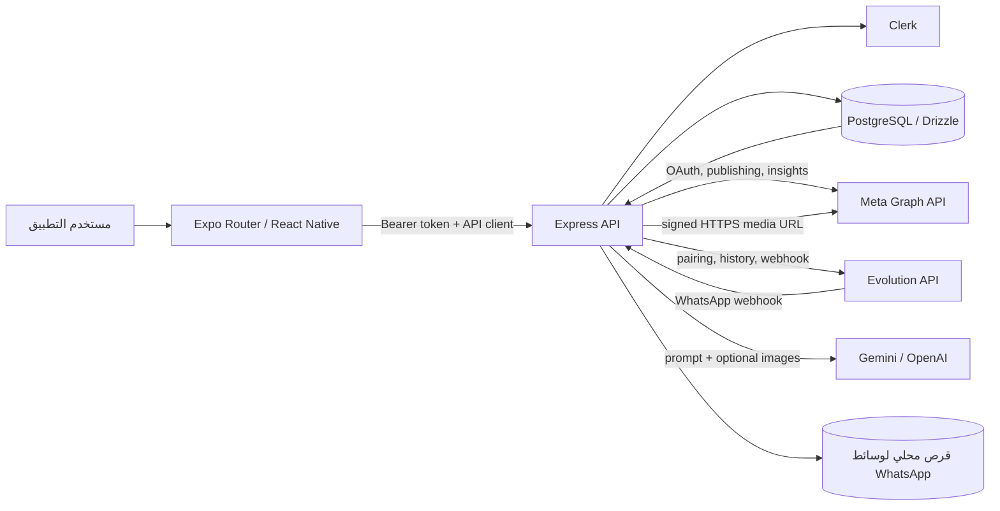

# تقرير التدقيق التقني الشامل — MenaFlow

**تاريخ التدقيق:** 2026-10-18  
**نطاق التدقيق:** نسخة العمل الحالية في مساحة VS Code، بما فيها التغييرات المحلية الموجودة مسبقًا.  
**نوع العمل:** مراجعة ساكنة للكود والإعدادات، مع تشغيل اختبارات الوحدة وفحوص الأنواع الآمنة. لم تُجرَ تغييرات على التطبيق أو قاعدة البيانات أو الخدمات الخارجية.

## 1. الملخص التنفيذي

MenaFlow في حالته الحالية عبارة عن تطبيق جوّال/متعدد المنصات مبني بـ Expo وReact Native، وخادم API مستقل بـ Express، وحزم مشتركة لعقود API وPostgreSQL/Drizzle. ليس المشروع تطبيق React/Vite موحدًا؛ يوجد تطبيق `mockup-sandbox` منفصل، لكنه ليس مسار تشغيل المنتج الأساسي.

هناك أساس حقيقي لإدارة المنشورات: واجهة لإنشاء المسودات، توليد نصوص بالذكاء الاصطناعي، ربط Meta عبر OAuth، نشر Facebook وInstagram من الخادم، واستيراد رسائل ومجموعات WhatsApp عبر Evolution API مع تنزيل الوسائط وتجميع بعضها في مسودات. يدعم النظام كذلك مزامنة بيانات أداء من Graph API في صفحة تفاصيل الحساب.

لكن المنتج ليس منصة إدارة اجتماعية مكتملة بعد:

- لا يوجد Inbox فعلي لإرسال أو الرد على رسائل WhatsApp أو رسائل/تعليقات Facebook وInstagram. تُعرض رسائل مجموعات WhatsApp كمصادر، لا كمحادثات قابلة للرد.
- لا توجد جدولة زمنية فعلية للمنشورات. حالة `scheduled` موجودة، لكن المخطط لا يحفظ موعدًا للنشر ولا يوجد عامل يعالج المنشورات المجدولة. العامل الخلفي الموجود خاص بصف معالجة محتوى WhatsApp.
- لا توجد وحدات منتجات أو طلبات أو عملاء أو مخزون أو مساحات عمل مشتركة بأدوار.
- ربط Instagram يتم من خلال Facebook، لكن OAuth لا يطلب صلاحية النشر `instagram_content_publish` مع أن كود النشر يستدعي مسارات إنشاء ونشر الوسائط؛ لذا لا يمكن اعتبار النشر متاحًا فعليًا لكل حساب بمجرد اكتمال الربط.
- يوجد مسار `quick-connect` تجريبي يكتب اتصال Meta وهميًا ولا يظهر عليه قيد بيئة تطوير.
- يوجد مفتاح قديم ثابت في مسار فك تشفير رموز Meta؛ الاختبارات تثبت أن النظام يقبل الرموز المشفرة بذلك المفتاح حتى عند غياب `ENCRYPTION_KEY`.
- واجهة التقارير تحتسب حالات المنشورات الداخلية، وليست كلها تحليلات تفاعل من المنصات. كما تسمح واجهة API بتعيين `published` ونتائج نشر من غير التحقق من نتيجة مزود خارجي.

**نتائج التحقق:** نجحت 96/96 من اختبارات `pnpm test`. نجحت فحوص أنواع API server وExpo وDB وحزم العميل/المخططات. لم يُشغّل البناء لأن سكربت بناء الخادم يحذف مجلد `dist` الموجود قبل بنائه، ولم تُطبّق migrations أو تُجرَ اتصالات نشر خارجية.

**أعلى المخاطر:** معالجة المفتاح القديم قبل اعتبار رموز Meta محمية بالكامل، إضافة صلاحية نشر Instagram ومراجعتها لدى Meta، تعطيل مسار الربط الوهمي خارج التطوير، منع تزوير حالة النشر، وتحديد ما إذا كان المنتج أحادي المالك أم SaaS متعدد المستخدمين/المؤسسات.

## 2. وصف المشروع وبنيته التقنية المكتشفة

| الجزء | التنفيذ الموجود |
|---|---|
| تطبيق المستخدم | Expo Router، React Native/React Native Web، TypeScript. المسارات الأساسية تحت `artifacts/menaflow-mobile/app`. |
| الخادم | Express 5 وNode.js/TypeScript تحت `artifacts/api-server`. نقطة البدء `src/index.ts`، والتطبيق/الوسائط في `src/app.ts`. |
| المصادقة | Clerk (`@clerk/expo` و`@clerk/express`) مع رمز Bearer يضيفه عميل API. يوجد مفتاح محلي لتعطيل المصادقة في التطوير فقط. |
| قاعدة البيانات | PostgreSQL عبر `pg` وDrizzle ORM، مخططها في `lib/db/src/schema`. |
| عقود API | `lib/api-spec/openapi.yaml`، ومخرجات Orval/Zod والعميل المولد في `lib/api-zod` و`lib/api-client-react`. |
| الذكاء الاصطناعي | استدعاءات HTTP مباشرة إلى Gemini وOpenAI من الخادم؛ لا توجد مكتبة SDK مخصصة أو قاعدة معرفة/RAG. |
| Meta | Facebook Graph API وOAuth مركزي يربط صفحة Facebook وحساب Instagram الاحترافي المرتبط بها. |
| WhatsApp | Evolution API، وليس WhatsApp Business Platform Cloud API الرسمية. يتم استيراد الرسائل/المجموعات عبر مزامنة وWebhook. |
| تخزين الوسائط | نظام ملفات محلي تحت `artifacts/api-server/storage/whatsapp` مع بيانات وصفية في PostgreSQL؛ لا يظهر مخزن كائنات دائم مستقل. |
| التشغيل | workspace بـ pnpm. API منفصل عن تطبيق Expo. إعدادات التشغيل والتوزيع موثقة في ملفات المشروع. |
| الاختبارات | اختبارات Node للمكتبات المساعدة؛ لا توجد ضمن السكربتات المعلنة اختبارات API/DB متكاملة أو اختبارات واجهة آلية. |

**إصدارات الأساس كما تعلنها ملفات المشروع:** Node.js 24 في وثائق النشر، TypeScript 5.9 في الجذر/الخادم و6.0.3 لتطبيق Expo، Express 5، Expo SDK 57، React 19.2.3، React Native 0.86.3، PostgreSQL/Drizzle. إصدار Node المتاح أثناء التدقيق كان `v22.13.0`، لا الإصدار الموصى به في الوثائق.

## 3. خريطة معمارية مبسطة

لا يظهر في التنفيذ Redis أو مخزن مهام خارجي أو نظام تخزين كائنات أو طبقة مراقبة أخطاء مثل Sentry. صف معالجة WhatsApp محفوظ في PostgreSQL ويعالجه مؤقّت polling داخل عملية الخادم.

## 4. الصفحات والوحدات والوظائف الموجودة

**المسارات الظاهرة في التطبيق:** تسجيل الدخول والتسجيل، الرئيسية، المحتوى، المصادر، التقارير، الإعدادات، إنشاء منشور، تفاصيل حساب حسب المنصة، عودة OAuth من Meta، وصفحة not-found. الشاشات معرفة في `artifacts/menaflow-mobile/app`.

**الوحدات في API:** فحص الصحة، صلاحية الوصول، توليد محتوى AI، اتصالات Meta وWhatsApp، اختيار/قراءة مجموعات WhatsApp ورسائلها ووسائطها، إعدادات النشر التلقائي، منشورات CRUD، النشر اليدوي، التحقق من نتيجة Facebook، وتفاصيل الحساب/الأداء.

لا توجد مسارات API للمحادثات أو الردود أو التعليقات، ولا مخططات DB للمنتجات والطلبات والعملاء أو أعضاء ومساحات العمل.

## 5. مصفوفة اكتمال الميزات

| الوحدة | الحالة | الدليل والملاحظة |
|---|---|---|
| التسجيل/المصادقة | مكتمل جزئيًا | تدفقات Clerk ظاهرة في شاشات sign-in/sign-up و`OwnerGuard`؛ يلزم حسم/تطبيق سياسة المالك (انظر BUG-006). |
| عزل سجل المنشورات | مكتمل جزئيًا | عمليات القراءة والكتابة الرئيسية تقيد `ownerId`؛ لا يوجد مفهوم workspace/member أو صلاحيات داخل المؤسسة. |
| حسابات Facebook | مكتمل جزئيًا | OAuth، تخزين رمز مشفر، نشر وقراءة تفاصيل/مقاييس؛ نجاح حساب فعلي يتوقف على الإعدادات والصلاحيات الخارجية. |
| حسابات Instagram | مكتمل جزئيًا | ربط حساب احترافي عبر صفحة Meta ومسار نشر وسائط موجود؛ صلاحية النشر غير مطلوبة في OAuth، فلا يثبت أن النشر ممكن (BUG-002). |
| WhatsApp/Evolution | مكتمل جزئيًا | ربط/حالة اتصال، مزامنة مجموعات ورسائل، webhook ووسائط ومصادر؛ لا يوجد إرسال أو Inbox. |
| إنشاء المحتوى | مكتمل جزئيًا | مسودات يدويًا أو بمخرجات OpenAI/Gemini، وتحرير/حفظ بالخادم؛ لا توجد مكتبة أصول/معاينة نشر متكاملة لكل المنصات. |
| تجميع رسائل WhatsApp | مكتمل جزئيًا | خوارزميات انتظار وتجميع وتفادي بعض التكرار وترتيب الوسائط؛ الوسائط غير المكتملة/الفيديو وبعض الحالات تُحال للمراجعة اليدوية. |
| النشر اليدوي | مكتمل جزئيًا | كود Facebook وInstagram يتعامل مع نص/صور/فيديو/ألبوم بقيود صريحة؛ لم يُختبر على حساب Meta حقيقي، وصلاحيات Instagram ناقصة. |
| النشر التلقائي | مكتمل جزئيًا | مدعوم لمحتوى WhatsApp المؤهل فقط مع إعدادات القنوات وفحوص أمان؛ ليس نشرًا تلقائيًا عامًا لكل مسودة. |
| جدولة المنشورات | واجهة/حالة فقط | قيمة `scheduled` وتسجيل حدث موجودان، لكن لا يوجد حقل موعد أو عامل نشر مؤجل. |
| Inbox/الردود والتعليقات | غير منفذ | لا يوجد endpoint لإرسال رد WhatsApp/Meta ولا استقبال رسائل/تعليقات Meta أو Webhooks لها. |
| الرد الآلي لخدمة العملاء | غير منفذ | AI ينشئ محتوى تسويقيًا/مسودات؛ لا يوجد مسار من رسالة عميل إلى إجابة ثم إرسالها. |
| مصادر/قاعدة معرفة | مكتمل جزئيًا | مصادر WhatsApp ومزامنة سجل المجموعات؛ لا تظهر قاعدة معرفة قابلة للإدارة أو استرجاع معرفة للردود. |
| منتجات/طلبات/عملاء/مخزون | غير منفذ | لم يظهر نموذج DB أو routes أو صفحات تخص هذه الوظائف. |
| التقارير | مكتمل جزئيًا | إحصاءات داخلية من حالات المنشورات، وتفاصيل حساب من Graph API؛ لا توجد لوحة شاملة للرسائل والردود أو قياس نجاح النشر لكل القنوات في شاشة التقارير. |
| الإعدادات/الإشعارات | مكتمل جزئيًا | تفضيلات محلية وإعدادات مزامنة/نشر تلقائي؛ لا يظهر نظام إشعارات دفع أو خدمة إشعارات خلفية. |
| الاختبارات | مكتمل جزئيًا | 96 اختبار وحدة/منطق مساعد؛ لا توجد اختبارات تشغيل end-to-end أو تكاملات حية. |
| النشر والتشغيل | تعذر التحقق | توجد وثائق تشغيل، لكن إعدادات منصة النشر الفعلية غير موجودة في نسخة العمل؛ لم تُفحص بيئة خارجية. |

## 6. تحليل الواجهة الأمامية

- يستخدم التطبيق React Native مع Expo Router وReact Query وعميل API مولد. `StudioContext` يقرأ ويكتب المنشورات من الخادم، يخزن نسخة محلية في AsyncStorage، ويستمع لتغييرات المنشورات عبر Server-Sent Events في بيئات تدعم `ReadableStream`.
- شاشات المنتج عربية، تستخدم خط Cairo وتضبط RTL على الأنظمة غير Web. لا أجري هنا اختبار عرض مرئي عبر أجهزة/متصفحات، لذلك لا أؤكد مطابقة كل breakpoint أو مستوى التباين/الوصولية.
- المسارات تشمل الرئيسية والمحتوى والمصادر والتقارير والإعدادات وتفاصيل الحساب والتأليف والمصادقة. لا توجد شاشة Inbox أو إدارة طلبات/مخزون.
- أزرار إنشاء المنشور، التوليد بالذكاء الاصطناعي، إدارة المصادر، اختيار مجموعات WhatsApp، حذف/تعديل المحتوى والنشر تستدعي API أو context. زر النشر ليس دليلًا على قبول Meta، وتعرض صفحة المحتوى نتائج API.
- `StudioContext.tsx` يستخدم تحديثًا تفاؤليًا ويحتفظ بالتغيير المحلي عند فشل بعض طلبات الإنشاء/التعديل/تغيير الحالة؛ بعض أخطاء المزامنة تُسجل في console بدل عرض حالة فشل واضحة للمستخدم (BUG-008).
- شاشات التقارير تحتسب المنشورات حسب `status` محليًا، ولا تعرض بيانات وصول/مشاهدات في لوحة التقارير نفسها. بطاقة WhatsApp تعرض «غير مربوط» ثابتًا، كما أن `hasConnections` يحسب Facebook وInstagram فقط (BUG-007).
- التطبيق يحفظ بيانات المنشورات بما فيها نص المصدر في AsyncStorage؛ لم يظهر تشفير لتلك النسخة المحلية في الكود المفحوص.

## 7. تحليل Backend وواجهات API

`src/app.ts` يركّب Pino HTTP logging، CORS، محلل JSON، Clerk، ومسارات `/api`. مسارات API الفعلية تشمل:

- `/auth/access`, `/ai/content`
- `/social/connections`, `/social/meta/*`
- `/social/whatsapp/*` بما فيها pairing/group sync/messages/media/webhook
- `/posts`, `/posts/:id`, `/posts/:id/publish`, `/posts/:id/verify-facebook`
- `/social/account-details/:platform` و`/healthz`

المسارات الأساسية تستخدم `requireOwner`، وتقيّد بيانات المنشورات والرسائل والحسابات بمعرف مالك الطلب. مصادقة API مبنية على Clerk. لا يوجد تحقق API لعضوية مساحة عمل أو دور مستخدم منفصل.

معالجة الأخطاء موجودة بمزيج من رسائل عربية للمستخدم وPino/console. لا توجد حدود عامة للمعدل على كل API؛ توليد AI وحده يحد الطلبات إلى 8/دقيقة لكل معرف مستخدم داخل خريطة ذاكرة العملية، وهي ليست حدًا مشتركًا بين عدة نسخ للخادم.

يوجد OpenAPI وعملية codegen، لكن تغطية OpenAPI الظاهرة لا تعني وجود وظائف المحادثات؛ لا توجد مسارات رسائل/ردود في routes.

## 8. تحليل قاعدة البيانات

Drizzle يعرف جداول `mena_posts`, `mena_content_settings`, `mena_content_jobs`, `mena_post_activity_events`، واتصالات Meta وOAuth state، واتصالات WhatsApp والمجموعات وحالات المزامنة والرسائل والوسائط. توجد قيود فريدة مفيدة على رسالة WhatsApp الخارجية ضمن المالك/المثيل/المجموعة، وعلى وسائطها.

جداول المنتج تستخدم `owner_id` في المسارات الأساسية، لكن لا يوجد جدول workspace أو membership/role أو علاقات متجر/عميل/منتج/طلب. حقل `posts.status` نصي؛ لا يوجد `scheduled_at` أو حقل منطقة زمنية. `mena_content_jobs` مصمم لمعالجة رسائل WhatsApp، وليس صفًا لجدولة المنشورات. إعداد DB يستخدم `DATABASE_URL`، ويوجد `drizzle-kit push` لكن لم يُنفذ؛ لا يثبت هذا التدقيق حالة قاعدة البيانات الفعلية أو تطابقها مع المخطط.

## 9. تحليل WhatsApp وEvolution API

- الوثائق تسمي Evolution API v2.3.7؛ مسار الاتصال ينشئ مثيلًا مخصصًا لكل مالك، يطلب QR/رمز pairing ويتحقق من حالة الاتصال ويضبط webhook.
- مزامنة تاريخ المجموعة والويبهوك يستورد أحداث upsert/update/delete إلى جداول WhatsApp؛ استقبال الحدث يقارن مفتاح Evolution من header بمفتاح إعداد الخادم ويتحقق من مثيل ومجموعة مختارة. يوجد unique index لمنع إدخال الرسالة ذات المعرف نفسه أكثر من مرة.
- توجد معالجة لتجميع الألبومات وربط النص والوسائط، ومهلات انتظار للرسائل والوسائط، وترتيب بمعرف/فهرس المجموعة. الوسائط تُنزّل إلى القرص المحلي. صور مختارة تمر إلى AI لإنشاء مسودة؛ الفيديو وبعض صيغ الوسائط/الحالات غير المكتملة تُحال لمراجعة يدوية. إعداد النشر التلقائي مقيد بقواعد أهلية وهوية المرسل والقنوات المرتبطة.
- صف المعالجة محفوظ في DB ويُطالب به عبر transaction و`FOR UPDATE SKIP LOCKED`، ويُستعاد العمل المتوقف بعد مهلة. لكنه يعمل بواسطة polling داخل عملية API كل 3 ثوان، ولا يوجد عامل مستقل أو مراقبة/تنبيه تشغيلي.
- لا توجد route لإرسال رسالة WhatsApp أو الرد على مرسل/مجموعة؛ صفحة المصادر لا تحقق وظيفة Inbox.
- لم تُختبر جلسة Evolution أو webhook حقيقيًا. لا يمكن إثبات استمرارية بيانات الجلسة أو استقرار عناوين webhook في الاستضافة الحالية.

## 10. تحليل Facebook وMeta API

مسار OAuth يستخدم state عشوائيًا أحادي الاستخدام بمدة محدودة، يبادل الرمز، يختار صفحة متاحة، يحاول الوصول لحساب Instagram الاحترافي المرتبط، ويخزن رمز الصفحة مشفرًا. كود النشر يدعم Facebook feed/text، صورة، فيديو، وألبوم صور بشروط؛ يسجل نتائج لكل قناة ويستعلم permalink عند توفره. تفاصيل الحساب تقرأ منشورات/مقاييس من Graph API.

الصلاحيات المطلوبة تشمل `pages_show_list`, `pages_read_engagement`, `pages_manage_posts`, `read_insights`, `instagram_basic`, `instagram_manage_insights`. لا يظهر استقبال Webhooks لتعليقات أو رسائل Facebook ولا endpoints للرد عليها. لا يمكن إثبات موافقة Meta للتطبيق أو الصلاحيات الفعلية من الكود وحده.

## 11. تحليل Instagram

الربط ليس OAuth مستقلًا: يبحث التطبيق عن `instagram_business_account` ضمن صفحة Facebook ويحفظ معرف الحساب والاسم. النشر يستخدم Graph API لإنشاء container، ينتظر حالته، ثم يستدعي `media_publish`، ويدعم صور JPEG وفيديو MP4 وألبومات ضمن الحدود التي يطبقها الكود. لوسائط WhatsApp يستخدم روابط موقعة تتطلب أصل HTTPS عام، مع نطاق عام مضبوط صراحة أو أداة tunnel محلية مؤقتة للتطوير.

**فجوة واضحة:** قائمة OAuth في `routes/meta.ts` لا تتضمن `instagram_content_publish`، مع أن التنفيذ يستدعي نشر محتوى Instagram. يلزم طلبها ومراجعة صلاحيات التطبيق/النوع والحساب لدى Meta قبل ادعاء توفر النشر (BUG-002). لا يوجد اتصال نشر تجريبي في هذا التدقيق.

## 12. تحليل الذكاء الاصطناعي والرد الآلي

- `/ai/content` يرسل الفكرة والسياق التجاري الاختياري إلى OpenAI أو Gemini من الخادم ويعيد نص مسودة؛ توجد مهلة 30 ثانية وحدّ معدل داخل ذاكرة العملية.
- AI الخاص بمحتوى WhatsApp يحلل نصًا وصورًا لإنشاء مسودات منفصلة لفيسبوك/إنستغرام، مع قواعد تمنع اختراع معلومات تجارية وتستثني بعض المحتوى الشخصي/غير المدعوم. يُرسل النص/الصور إلى مزود AI المحدد إذا كانت مفاتيحه مضبوطة.
- لا توجد إدارة مصادر معرفة قابلة للاسترجاع، ولا دليل على grounding على بيانات منتجات/مخزون، ولا ذاكرة محادثات خدمة عملاء أو قواعد موافقة لإرسال الردود.
- إذًا الموجود هو توليد محتوى وتسويق، وليس ردًا آليًا على WhatsApp أو رسائل وتعليقات Meta. لا يظهر تكامل AI مع endpoints إرسال لأن تلك المسارات غير موجودة.
- مسار WhatsApp يسجل مقتطفًا يصل إلى 1000 حرف من مخرجات النموذج في `console.debug`؛ ينبغي مراجعة أثر ذلك على سجلات الإنتاج والاحتفاظ بالبيانات.

## 13. إنشاء المحتوى والنشر والجدولة

رحلة المحتوى الموجودة: إنشاء يدوي أو توليد AI في التطبيق → حفظ المسودة على الخادم → مراجعة/تعديل → طلب نشر فوري إلى Facebook/Instagram → تخزين نتيجة القناة ومعرف المنشور/الرابط أو سبب الفشل. توجد حماية من تكرار بعض المحاولات، ونتيجة `unknown` لفشل غير محسوم في Facebook مع مسار تحقق.

يوجد نشر تلقائي محدود لمحتوى WhatsApp المصدر عند تفعيل الإعداد واستيفاء أهلية الرسالة وربط كل القنوات. لا يوجد نشر تلقائي عام للمسودات ولا موعد نشر مخزن. قيم `scheduled` وحدث `post_scheduled` لا تنشئ مهمة تنفيذ مؤجلة؛ لذلك لا تعمل كجدولة فعلية. كما أن API يسمح بتغيير حالة/نتائج المنشور يدويًا من غير المرور بمزود النشر (BUG-005).

## 14. تحليل الرسائل والتعليقات

| القناة | المستلم/العرض | إرسال يدوي | AI auto-reply | الحالة الفعلية |
|---|---|---|---|---|
| WhatsApp | مزامنة مجموعات ورسائل ووسائط إلى صفحة المصادر | غير موجود | غير موجود؛ AI ينشئ مسودة محتوى | استيراد مصادر جزئي، بلا Inbox أو رد |
| Facebook | تفاصيل صفحة ومنشورات ومقاييس عامة من Graph | غير موجود | غير موجود | لا استقبال رسائل/تعليقات أو ردود |
| Instagram | تفاصيل الحساب ومنشوراته ومقاييسه | غير موجود | غير موجود | لا استقبال DM/تعليقات أو ردود |

المخطط يحتوي رسائل WhatsApp، لكنه لا يحتوي سجل محادثة موحدًا للمنصات ولا ربط عملاء أو ردود.

## 15. التقارير والإحصائيات

`reports.tsx` يحسب إجمالي المنشورات والمسودات والمراجعة والمنشورة والمجدولة من بيانات المنشورات التي جلبها API. هذه أرقام داخلية وليست reach/impressions. صفحة تفاصيل الحساب تستخدم Graph API لجلب مؤشرات ومنشورات Facebook/Instagram، و`facebook-performance.ts` يحسب أداء النشر المسجل داخليًا من المنشورات وأحداث النشاط.

لا تعرض لوحة التقارير المركزية عدد الرسائل/التعليقات/الردود أو إحصاءات اجتماعية موحدة. عدّ المنشورات المنشورة يعتمد على `status` المحفوظ؛ يمكن لـAPI إنشاء منشور `published` أو تعديل `status` و`publishResults` من دون نتيجة خارجية، لذا الرقم لا يضمن دائمًا نجاح النشر من Meta. بطاقة WhatsApp في التقارير تعرض «غير مربوط» حتى عند وجود اتصال WhatsApp (BUG-007).

## 16. تحليل الأمن والخصوصية

**إيجابيات موجودة:** Clerk للحسابات، Bearer token إلى API، تقييد كثير من استعلامات DB بمعرف المالك، AES-GCM لتشفير رموز Meta الجديدة بمفتاح بيئة، توقيع HMAC لروابط الوسائط العامة القصيرة العمر، وتحقق من مفتاح Webhook. لم تظهر كلمات مرور أو رموز فعلية في التقرير.

**مخاطر/حدود:**

- مفتاح ثابت قديم لا يزال يستخدمه `decryptMetaToken` كـfallback، وتثبت الاختبارات قبول فك التشفير به دون `ENCRYPTION_KEY` (BUG-001). هذا يعرض أي token ciphertext قديم بهذا المفتاح للخطر إذا حصل طرف على نسخة DB/الشفرة.
- `quick-connect` يزرع سجل Meta تجريبيًا مع token وهمي ولا يظهر أنه مقيد بـ`NODE_ENV` (BUG-003).
- `MENA_OWNER_EMAIL` لا يستخدم لمقارنة البريد المصادق؛ `/auth/access` يتحقق من وجود المتغير فقط ثم `isOwnerRequest` يعيد السماح لأي مستخدم Clerk مسجل. إذا كانت السياسة «مالك واحد»، فهي غير مفروضة؛ أما إذا كان المطلوب SaaS متعدد المستخدمين، فالعزل بالمالك موجود لكن لا توجد عضوية/أدوار مؤسسة (BUG-006).
- عند تعطيل المصادقة محليًا، عدم ضبط `MENA_OWNER_EMAIL` يعيد معرفًا ثابتًا مشتركًا للتطوير. هذا محصور بشرط `NODE_ENV=development` و`MENA_AUTH_DISABLED=true` لكنه قد يخلط بيانات بيئة تطوير مشتركة.
- `cors()` مستخدم دون allowlist ظاهر. لا يثبت ذلك وحده تجاوز المصادقة، لكنه يجعل سياسة الأصول المفتوحة بحاجة إلى مراجعة قبل الإنتاج.
- AsyncStorage والوسائط المحلية لا يظهر عليهما تشفير/نسخ احتياطي دائم في المشروع. رسائل ومحتوى عملاء قد توجد ضمن هذه البيانات.
- يتم إرسال المحتوى/الصور لمزودي AI، كما يُسجّل مقتطف من مخرجات AI؛ لم أتحقق من الموافقة أو سياسة الاحتفاظ أو إعدادات logging خارج الكود.
- لم يُشغّل تدقيق CVE للتبعيات أو اتصال registry. لذلك لا يوجد استنتاج عن خلو الاعتماديات من ثغرات معروفة.

## 17. نتائج الاختبارات والأوامر التي شُغّلت

| الأمر | النتيجة |
|---|---|
| `pnpm test` | **نجاح: 96 اختبارًا، 0 فشل**. ظهر تحذير Node بأن Type Stripping تجريبي، وتحذير package type لمصدر اختبار Expo. |
| `pnpm --filter @workspace/api-server run typecheck` | نجاح؛ `tsc -p tsconfig.json --noEmit`. |
| `pnpm --filter @workspace/menaflow-mobile run typecheck` | نجاح؛ `tsc -p tsconfig.json --noEmit`. |
| `pnpm --filter @workspace/db exec tsc -p tsconfig.json --noEmit` | نجاح. |
| `pnpm --filter @workspace/api-client-react exec tsc -p tsconfig.json --noEmit` | نجاح. |
| `pnpm --filter @workspace/api-zod exec tsc -p tsconfig.json --noEmit` | نجاح. |

لم يُشغّل `build`: سكربت خادم API يحذف `artifacts/api-server/dist` قبل البناء، ومجلد build موجود، كما يبني تطبيق Expo مخرجات static؛ تجنبت الكتابة فوق مخرجات محلية. لم تُشغّل `db:push` أو scripts الخاصة بتعديل/تقرير قاعدة البيانات، ولم تُختبر الواجهة على جهاز أو حساب خارجي.

## 18. تحليل الاستضافة والتشغيل

- API يتطلب `PORT` ويتحقق من صحته عند البدء؛ `/api/healthz` يقدم health endpoint.
- API يحمّل ملفات `.env` تلقائيًا عبر سكربتات التطوير/DB، لكن لم أفتح `.env` أو `.env2` ولم أقرأ قيمًا أو أسرارًا.
- `.env.example` يسرد أسماء متغيرات DB/Clerk/Meta/Evolution/AI/media؛ **حالة ضبط قيم التشغيل الفعلية تعذر التحقق منها**. وجود الأسماء في المثال ليس دليلًا على تهيئة الخدمة.
- وثائق التشغيل تحدد `MENA_PUBLIC_MEDIA_BASE_URL` أو domain عام وروابط HTTPS لتتمكن Meta من جلب وسائط Instagram؛ وتوثق tunnel مؤقتًا للتطوير. لم أختبر أي عنوان أو خدمة.
- تخزين الوسائط محلي تحت مجلد المشروع؛ استمراريته عبر إعادة النشر/تعدد نسخ الخادم غير مثبتة. لا يوجد إعداد تخزين دائم/سحابي ظاهر.
- لا توجد في الحالة الحالية ملفات Docker أو Compose أو GitHub Actions أو إعدادات نشر مخصصة.
- التسجيل عبر Pino موجود؛ لا يظهر تكامل مراقبة أخطاء/تنبيهات أو لوحة تشغيل.

## 19. خريطة المشكلات والأولويات

| ID | الشدة / الأولوية | المشكلة والدليل | الأثر وخطوات إعادة الإنتاج | السبب/ما يجب التحقق منه | اتجاه الإصلاح والاعتماديات |
|---|---|---|---|---|---|
| BUG-001 | **مرتفع / P1** | `artifacts/api-server/src/lib/meta-token-crypto.ts:8-43` يحتوي مفتاح فك تشفير قديم ثابتًا؛ `decryptMetaToken` يجربه حتى دون `ENCRYPTION_KEY`. اختبار `meta-token-crypto.test.mjs` يثبت هذا السلوك. | إذا كانت سجلات DB القديمة مشفرة بالمفتاح، فنسخة DB مع معرفة المستودع تكفي لاستعادة رموز صفحات Meta. | لا يمكن من دون DB معرفة هل توجد سجلات قديمة بهذا التنسيق أو كم عددها. | جرد السجلات القديمة، إعادة تشفيرها بمفتاح سري مُدار، ثم إزالة fallback واختبار فشل فك القديمة. يعتمد على وصول آمن لنسخة DB وإدارة المفاتيح. |
| BUG-002 | **مرتفع / P1** | `routes/meta.ts:31-37` لا يطلب `instagram_content_publish`؛ `lib/meta-publishing.ts:427-524` ينشئ container وينادي `media_publish`. | الربط قد ينجح وتفشل عملية النشر لصلاحية مفقودة. أعِد الاختبار بحساب اختبار بعد طلب الصلاحية وموافقة Meta، دون حساب إنتاج. | حالة تطبيق Meta/المراجعة والصلاحيات الممنوحة غير متاحة. | تحديث scopes والتحقق من متطلبات Meta ومراجعة التطبيق، ثم اختبار نشر staging للصور والفيديو والألبوم. يعتمد على إعدادات Meta وموافقتها. |
| BUG-003 | **متوسط / P1** | `routes/meta.ts:249-302` يعرّف `/social/meta/quick-connect` مع قيم اتصال تجريبية ورمز غير حقيقي؛ لا يظهر شرط بيئة. | استدعاء API بمستخدم مصادق ينشئ اتصالًا يبدو مرتبطًا؛ وقد يبدل معرفات اتصال المالك ويجعل النشر/التفاصيل مضللة. | المسار غير ظاهر في الواجهة المفحوصة؛ تحقق من استخدامه في بيئات أخرى وسجلات الوصول. | إزالته أو حمايته بعلم تطوير صريح، وعدم إرجاع اتصال وهمي في build إنتاج. اختبر ألا يبقى في OpenAPI/العميل الإنتاجي. |
| BUG-004 | **متوسط / P1** | `lib/db/src/schema/posts.ts` لا يحتوي موعد نشر؛ `routes/posts.ts` يسمح بـ`scheduled` ويسجل حدثًا فقط. العامل في `src/index.ts:26-33` يعالج `processWhatsAppMarketingQueue` فقط. | إنشاء منشور `scheduled` لا ينتج عنه نشر في موعد لاحق، ولا توجد منطقة زمنية/استعادة جدولة. | لا توجد آلية جدولة خارجية ظاهرة في ملفات المشروع؛ إعدادات المنصة الخارجية غير متاحة. | إضافة موعد UTC ومنطقة زمنية/سياسة واضحة، صف عمل durable وقفل/idempotency/retry ثم worker. يعتمد على تصميم قاعدة البيانات والاستضافة. |
| BUG-005 | **متوسط / P1** | `routes/posts.ts:325-398, 415-520` يقبل إنشاء حالة `published`، وPATCH يقرأ `rawBody.publishResults` ويخزنها رغم أن مخطط Update لا يعرّفها. | طلب مصادق مثل `POST /posts` بحالة published أو `PATCH /posts/:id` بحالة/نتيجة مصطنعة يجعل التقارير تعرض نجاحًا لم يحدث. | لا يلزم وصول Meta لإعادة إنتاجه؛ يلزم التحقق إن كان مستخدم داخلي/تكامل يعتمد هذا السلوك. | فرض انتقالات حالة على الخادم، جعل نتائج المزود غير قابلة للتحرير من endpoint العام، وعدم قبول published إلا بعد نتيجة publish موثقة. تحديث العملاء/العقود واختبارات API. |
| BUG-006 | **متوسط / P1 مشروط** | `lib/owner-access.ts:21-52` يعتبر كل Clerk user مصادق مالكًا؛ `routes/access.ts:16-20` يتحقق من وجود `MENA_OWNER_EMAIL` فقط ولا يقارن البريد. | إن كان المقصود حساب مالك وحيد، فحساب Clerk آخر يمر `authorized=true`. لا يظهر دليل على تسرب بيانات بين المالكين لأن استعلامات DB الأساسية تقيد ownerId. | اسأل مالك المنتج هل المطلوب SaaS ذاتي التسجيل أم allowlist لمالك واحد. | إما تنفيذ allowlist مبنيًا على هوية Clerk موثقة، أو تغيير تسمية/سياسة OwnerGuard وتوثيق نموذج multi-tenant، ثم اختبارات فصل المستخدمين والأدوار. |
| BUG-007 | **منخفض / P2** | `app/(tabs)/reports.tsx:32, 145-153` يحسب الاتصال من Facebook/Instagram فقط ويعرض WhatsApp «غير مربوط» ثابتًا. | عند اتصال WhatsApp دون Meta، تظهر حالة مضللة؛ وبقية وصف التقارير قد يعتبر أنه لا توجد اتصالات. | تحقق على شاشة التطبيق بعد ربط WhatsApp؛ لم يتم تشغيل UI. | اربط الحالة بـ`connections.whatsapp` الفعلية وأضف اختبار عرض لحالات كل قناة. |
| BUG-008 | **متوسط / P2** | `context/StudioContext.tsx:318-370` يخفي أخطاء إنشاء/تعديل/تغيير حالة المنشور ويترك optimistic state محليًا؛ بعض sync errors تُسجل فقط. | انقطاع الشبكة قد يجعل المستخدم يظن أن التغيير حفظ في DB، بينما لم يكتمل الطلب؛ تبقى بيانات محلية وقد تختلف عن الخادم. | لاختبار التكرار يلزم UI وAPI متاحان؛ لم تُجرَ تجربة شبكة. | أعِد نتيجة الخطأ إلى الواجهة، اعرض حالة pending/failed/retry، وميّز بوضوح بين النسخة المحلية والخادم. يعتمد على تصميم UX وحالات React Query. |
| BUG-009 | **متوسط / P2** | `social.ts` و`whatsapp-marketing.ts` يخزنان الوسائط على قرص محلي؛ لا يظهر مخزن كائنات أو ضمان persistence. `StudioContext.tsx` يخزن بيانات المحتوى في AsyncStorage. | فقد قرص/إعادة نشر أو جهاز مفقود قد يفقد مرفقات/نسخ محلية. لا يثبت الكود أن هناك نسخًا احتياطيًا أو تشفير جهاز. | تحقق من نوع القرص في الإنتاج وسياسة الاحتفاظ/النسخ الاحتياطي ومن بيانات الوسائط الموجودة؛ لم أفحص محتوى ملفات التخزين. | اعتماد storage دائم خاص، وسياسة تشفير/احتفاظ، واختبار استعادة الوسائط بعد restart. يعتمد على النشر وقواعد الخصوصية. |
| BUG-010 | **منخفض / P2** | `app/(tabs)/reports.tsx:23-26` يحسب الحالات الداخلية؛ `routes/posts.ts` يسمح بتغييرها كما سبق؛ التقارير لا تعرض في الصفحة المركزية بيانات تفاعل خارجية. | قد تُفهم أرقام المحتوى/المجدول على أنها نجاح أو موعد حقيقي، بينما هي عدّ حالات DB؛ اتصال WhatsApp معيب في البطاقة كذلك. | حدد تعريف مؤشرات المنتج ومصدر كل رقم. | فصل metrics الداخلية عن بيانات Graph API، تسمية الأرقام ومصدرها وفترتها، وإضافة اختبارات حساب. يعتمد على BUG-004/005. |

## 20. الوظائف الناقصة أو غير المكتملة

1. Inbox موحد واستقبال/إرسال الرسائل والردود اليدوية والآلية لكل قناة.
2. Webhooks Meta للرسائل والتعليقات، والتحقق من التوقيع، وربط الأحداث بحساب/عميل.
3. جدولة حقيقية مع موعد ومنطقة زمنية وعامل نشر ومراقبة retries.
4. صلاحية نشر Instagram ومراجعة دورة OAuth/صلاحيات الإنتاج.
5. قاعدة معرفة للمؤسسة/المتجر واسترجاع معزول لكل مساحة عمل.
6. إدارة المنتجات والعملاء والطلبات والمخزون.
7. عضوية مساحة العمل والأدوار والدعوات، إن كان المقصود multi-tenant مع فرق.
8. إشعارات دفع/داخل التطبيق موصولة بخدمة فعلية، وسياسات احتفاظ وحذف.
9. تخزين دائم للوسائط ومراقبة خدمة/عامل queue واختبارات تكامل وواجهة.
10. تقارير موحدة للرسائل والردود ونجاح النشر ومقاييس المنصات مع تعريف مصادرها.

## 21. المخاطر التقنية والاعتماديات بين المشكلات

- **أمن الرموز:** BUG-001 يتطلب معالجة قبل اعتبار أي نسخ احتياطية DB آمنة من استعادة رموز Meta القديمة.
- **موثوقية النشر:** BUG-002 يمنع اعتبار تكامل Instagram مكتملًا؛ BUG-005 يجعل حالة النجاح قابلة للتزييف؛ BUG-010 يستهلك هذه الحالة في التقارير.
- **النشر المجدول:** BUG-004 يحتاج قرار بيانات/منطقة زمنية واستضافة worker، وليس مجرد زر أو تغيير status.
- **نموذج الحسابات:** BUG-006 يعتمد على قرار المنتج. تصميم `ownerId` لكل مستخدم يحقق فصلًا أوليًا، لكنه لا يساوي مساحة عمل متعددة الأعضاء/الأدوار.
- **الاستضافة والوسائط:** BUG-009 يرتبط باستمرارية قرص المنصة وإمكان الوصول العام من Meta، ويجب حسمه قبل نشر الوسائط على نطاق إنتاج.
- **البيانات غير الموثقة:** قيم البيئة وخدمات Meta/Evolution/AI الخارجية لم يتم التحقق منها، فلا يمكن تأكيد أن أي حساب أو webhook يعمل في الإنتاج.

## 22. خطة تطوير مقترحة على مراحل

| المرحلة | المهمة والأولوية | الاعتماديات/الملفات المتوقعة | معيار قبول |
|---|---|---|---|
| 1 — حماية البيانات | P1: ترحيل وإلغاء مفتاح فك التشفير القديم؛ حصر الوصول إلى الربط التجريبي؛ تثبيت سياسة صلاحية المالك؛ منع تزوير حالة النشر | `meta-token-crypto.ts`, `routes/meta.ts`, `owner-access.ts`, `routes/access.ts`, `routes/posts.ts`, مخطط DB واختبارات API | لا ينجح فك أي token بمفتاح ثابت؛ quick-connect غير متاح في الإنتاج؛ حساب غير مصرح به يُرفض؛ لا يمكن تغيير `publishResults` أو status إلى published عبر CRUD. |
| 2 — تدفقات الوظائف الأساسية | P1: تنفيذ موعد نشر دائم، عامل نشر موثوق، وإظهار فشل الحفظ/المزامنة | `schema/posts.ts`, `routes/posts.ts`, `src/index.ts`, `StudioContext.tsx`, واجهة content | منشور بموعد UTC واحد ينشر مرة واحدة فقط بعد restart، مع timezone واضحة ونتيجة لكل قناة؛ فشل API يظهر للمستخدم ولا يُعرض كحفظ ناجح. |
| 3 — التكاملات والردود | P1/P2: طلب صلاحيات Instagram اللازمة ثم اختبارها؛ تصميم Inbox وreply API/Webhooks حسب صلاحيات المنصات؛ توثيق ما تدعمه كل قناة | `routes/meta.ts`, `meta-publishing.ts`, routes/schema API، صفحات جديدة للمحادثات، اختبارات التكامل | staging يثبت OAuth والصلاحيات، استقبال حدث واحد دون تكرار، وربط الرد الصحيح بالقناة والحساب والعميل؛ لا تُعرض وظائف Meta غير الممنوحة. |
| 4 — UX والتقارير | P2: إصلاح حالات الاتصال، تدفق الشبكة، تعريف مؤشرات التقارير، دعم empty/error/loading | `reports.tsx`, `content.tsx`, `sources.tsx`, `StudioContext.tsx`, `account-details` | حالات WhatsApp/Meta تطابق API؛ لا تعرض حالة ثابتة؛ كل رقم يوضح مصدره والفترة؛ اختبارات واجهة لحالات النجاح والفشل وعدم الاتصال. |
| 5 — اختبارات الإنتاج والموثوقية | P1/P2: اختبار DB/API وwebhooks/queue/media، مراقبة retries وقياسها، تدقيق اعتماديات، استعادة النسخ الاحتياطية | اختبارات `api-server`, DB migration/config, queue, logging/deployment | CI يشغل typecheck/unit/integration؛ اختبار restart/duplicate/failure ينجح؛ استعادة قاعدة ووسائط مثبتة؛ سجل لا يحتوي محتوى/أسرارًا غير لازمة. |
| 6 — الميزات المستقبلية | P3: قاعدة معرفة، فرق/أدوار، التجارة، تحليلات موحدة وإشعارات | نماذج/عقود/واجهات جديدة بعد قرار نطاق المنتج | لكل وحدة عقد API وعزل بيانات واختبارات صلاحيات ومعيار قبول مستقل؛ لا تبدأ قبل تثبيت نموذج workspace والخصوصية. |

لا توصي الأدلة بإعادة كتابة التطبيق؛ الموجود يوفر قاعدة قابلة للاستكمال بعد سد الفجوات الأمنية والوظيفية.

## 23. أسئلة تحتاج إجابة أو وصولًا خارجيًا

1. هل المنتج اشتراك ذاتي لمؤسسات متعددة، أم تطبيق مخصص لمالك واحد؟ وهل يحق لأي مستخدم Clerk التسجيل واستخدام مساحة مستقلة؟
2. هل تطبيق Meta في وضع تطوير أم Live؟ وهل حصل على مراجعة `instagram_content_publish` وأذونات الرسائل/التعليقات اللازمة؟
3. ما إصدار Evolution API الفعلي؟ وهل webhook محمي بالمفتاح المحدد ويصل إلى عنوان عام ثابت؟ وهل تخزين جلسة Evolution دائم؟
4. هل قرص الاستضافة دائم ومشترك بين كل نسخ الخادم؟ وما خطة النسخ الاحتياطي لوسائط WhatsApp؟
5. ما قيم حالة التشغيل الفعلية لمتغيرات `DATABASE_URL`, `PORT`, `CLERK_*`, `MENA_OWNER_EMAIL`, `ENCRYPTION_KEY`, `FACEBOOK_*`, `META_GRAPH_VERSION`, `WHATSAPP_EVOLUTION_*`, `MENA_PUBLIC_MEDIA_BASE_URL`, `OPENAI_*`, `GEMINI_*`, `EXPO_PUBLIC_*`؟ لم أفتح ملفات الأسرار ولم أتحقق من البيئة.
6. ما سياسة موافقة العملاء/الاحتفاظ عند إرسال رسائل/صور إلى Gemini أو OpenAI، وما سياسة حذف البيانات محليًا وعلى الخادم؟
7. هل النشر المجدول مطلوب الآن؟ ما تعريف timezone ووقت إعادة المحاولة؟ وما قرار القنوات المدعومة في الرد الآلي؟

## 24. الملفات المهمة وأدوارها

- `package.json`, `pnpm-workspace.yaml`: أوامر workspace والاختبارات والبناء.
- `.env.example`: أسماء متغيرات البيئة المثال؛ لا تحتوي هذه المراجعة على قيم تشغيل فعلية.
- `artifacts/menaflow-mobile/app`: المسارات والشاشات؛ `context/StudioContext.tsx` حالة المحتوى/التزامن.
- `artifacts/api-server/src/app.ts`, `src/index.ts`: middleware وتشغيل HTTP وpolling queue.
- `artifacts/api-server/src/routes`: API للمصادقة والوصول وMeta وWhatsApp والمنشورات وAI والتفاصيل.
- `artifacts/api-server/src/lib/meta-publishing.ts`: نشر Facebook/Instagram ووسائط Meta والروابط الموقعة.
- `artifacts/api-server/src/lib/whatsapp-marketing.ts`: تحويل رسائل WhatsApp إلى مسودات والنشر المؤهل والصف.
- `artifacts/api-server/src/lib/whatsapp-message-scope.ts`, `whatsapp-albums.ts`, `whatsapp-media-download.ts`: تحليل وربط/تنزيل وتجميع الوسائط.
- `artifacts/api-server/src/lib/meta-token-crypto.ts`: تشفير رموز Meta.
- `lib/db/src/schema`: مخططات Drizzle للمنشورات والاتصالات والرسائل.
- `lib/api-spec/openapi.yaml`, `lib/api-zod`, `lib/api-client-react`: عقود API والمخططات والعميل المولد.
- `scripts/migrate-whatsapp-albums.js`, `scripts/report-whatsapp-album-post-candidates.js`: أدوات صيانة بيانات؛ لم تُشغّل.
- `artifacts/mockup-sandbox`: تطبيق Vite تجريبي منفصل عن مسارات Expo المنتجية.

## 25. حدود التدقيق

- حالة Git كانت متسخة قبل بدء التدقيق: **162 مسارًا متغيرًا/محذوفًا/غير متتبع** بحسب العدّ أثناء الفحص. التقرير يصف نسخة العمل الحالية، وليس baseline نظيفًا أو إصدارًا منشورًا. لم أرجع أو أعدل أي تغيير سابق.
- لم أفتح `.env` أو `.env2` أو أنسخ أي سر، ولم أفحص محتوى مجلد تخزين WhatsApp المحلي.
- لم أجرِ اتصالًا حيًا بـMeta أو Evolution أو OpenAI/Gemini، ولم أنشر محتوى أو أرسل رسالة أو أغيّر حسابًا.
- لم أتحقق من حالة DB الفعلية أو migrations المطبقة، ولم أشغّل سكربتات تغير بيانات.
- لم يُشغّل بناء المشروع لأن سكربت البناء يحذف مخرجات موجودة، ولم أجرِ اختبارًا بصريًا على جهاز/متصفح.
- لم يُفحص سجل إنتاج أو إعداد استضافة فعلي، ولم يُشغّل فحص CVE للتبعيات؛ لذا تبقى هذه النقاط غير مؤكدة.
- بعض أدلة الملفات المولدة/المخططات قد تتأثر بالتغييرات المحلية الحالية؛ يلزم إعادة الاختبار على commit/بيئة نشر محددة قبل اتخاذ قرار إطلاق.
