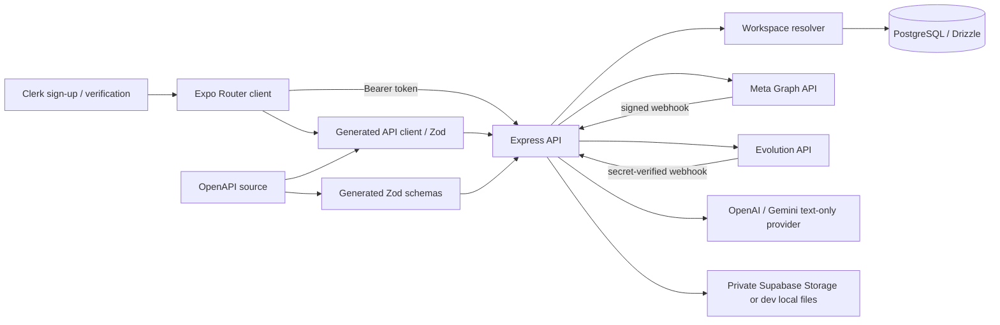

# التقرير الهندسي الشامل لمشروع MenaFlow

**تاريخ التدقيق:** 2026-11-08
**خط الأساس:** الفرع `main`، commit `2f3c5da`، وكانت شجرة العمل نظيفة قبل إنشاء هذا التقرير.
**النطاق:** مراجعة ساكنة للتوثيق، التطبيقات، API، مخططات Drizzle، ترحيلات Supabase، عقود API، والاختبارات. لم تُعدّل الشيفرة أو قاعدة البيانات أو الإعدادات؛ الملف الحالي هو الملف الوحيد المسموح إنشاؤه في هذه المهمة.

## 1. الملخص التنفيذي

MenaFlow مستودع pnpm متعدد الحزم لتطبيق Expo/React Native/Web وخادم Express وقاعدة PostgreSQL عبر Drizzle. المنتج الحالي أوسع من «إدارة المنشورات» وحدها: يتضمن ربط Meta ونشر المنشورات والـInbox والردود الآلية، مزامنة مجموعات ورسائل WhatsApp والرد الآلي على الرسائل الفردية، كتالوج منتجات واستخراج منتجات نصيًّا ومراجعتها ونشرها، ومساحات عمل واشتراكات وحدود استخدام.

الأساس الهندسي جيد في حدود الحزم، عقود API المولّدة، عزل مساحة العمل على مستوى middleware والاستعلامات، توقيع Webhooks، تشفير رموز Meta، معالجة مهام الخلفية باستخدام PostgreSQL، واختبارات وحدات للمنطق المهم. لا تظهر حاجة إلى إعادة كتابة المشروع أو إدخال خدمات مصغرة الآن.

مع ذلك، لا أوصي بإطلاق التغييرات الوظيفية المتعلقة بالوسائط/المنتجات أو الاعتماد على جودة التقارير قبل معالجة النتائج عالية الأولوية أدناه. أهمها: مسار وسائط المنشور اليدوي لا يتوافق مع مخزن وسائط المنتجات، مسار نشر المنشور العام لا يفرض حالة التحقق للمنتجات إذا أُرسل نوع المصدر الخام، واستخراج المنتجات يقبل سعرًا أو عملة لا يطابقان دلالة الاقتباس. كما أن حالة `scheduled` لا تنفذ جدولة، والأرقام في شاشة التقارير قد تمثل أول 20 منشورًا فقط.

**النتائج الرئيسية:**

- لا توجد ثغرة عزل بين مساحات العمل أثبتها هذا التدقيق، لكن لا توجد اختبارات تكامل شاملة لكل المسارات ولا اتصال قاعدة بيانات آمن متاح للتحقق الحي.
- ترحيل قديم يحذف رسائل ووسائط WhatsApp مباشرة قبل إسقاط جداول مراسلة؛ يجب التحقق من حالة تطبيقه وبياناته قبل أي ترحيل مستقبلي.
- مجموعة الاختبارات شغّلت 308 اختبارات: 307 ناجحة وواحدة فاشلة بسبب توقع رسالة خطأ قديمة. نجح فحص TypeScript في حزم workspace السبع.
- لم يُشغّل build أو lint أو E2E أو اختبار قاعدة بيانات. سكربتات البناء تمسح مجلدات مخرجات قائمة، وحالة قاعدة البيانات والبيئة المستهدفة غير متحققة.
- لا توجد حاليًا وحدات طلبات أو مخزون أو CRM. لا تُعرض كميزات مكتملة في المنتج قبل قرار نطاق منفصل.

**تحديث لاحق — 2026-11-09:** بدأ تنفيذ النسخة الداخلية الأولية للطلبات بعد تاريخ خط أساس هذا التقرير: أضيفت جداول وواجهات API وشاشة عربية مرتبطة بالـInbox. اجتازت فحوص النوع واختبارات منطق الطلبات، لكن لم تُطبّق migration على قاعدة بيانات ولم تُنفذ اختبارات تكامل أو قبول حي؛ لذلك لا تزال غير جاهزة للإنتاج.

## 2. المنهجية وحدود الأدلة

قُرئت `AGENTS.md` ووثائق المنتج والهيكل والنشر والبيانات وWhatsApp وتقارير التدقيق السابقة. جرى جرد الملفات والحزم، تتبع المسارات من واجهة المستخدم عبر API إلى مخطط البيانات، والبحث عن استخدامات وقيود RLS وعلاقات workspace والـworkers.

لم يُفتح `.env` أو أي ملف أسرار، ولم تُجرَ استعلامات DB أو طلبات إلى Meta/Evolution/OpenAI/Gemini. لا يمكن تأكيد اسم قاعدة البيانات الحية أو حالة تطبيق migrations أو إعداد Clerk/Meta في لوحات المزودين. لم أفتح التطبيق بصريًا؛ تشغيل واجهة موثقة مسبقًا قد يستخدم API وبيئة DB غير معروفة، لذلك لا أعد نتيجة العرض أو التفاعل الحي دليلًا في هذا التقرير.

**الفحوصات الآمنة المنفذة:**

| الفحص | النتيجة |
|---|---|
| `pnpm test` | 308 اختبارات: 307 نجاح، 1 فشل. الفشل في `owner-access.test.mjs` يتوقع نص الخطأ القديم، بينما الكود ما زال يرفض مفاتيح Clerk الاختبارية دون علم استثناء ويصدر رسالة أحدث. |
| TypeScript، مع `--noEmit` وملفات build info مؤقتة خارج المستودع | نجاح في `api-zod`, `api-client-react`, `db`, `api-server`, `menaflow-mobile`, `mockup-sandbox`, `scripts`. |
| فحص المسافات/حالة Git | المستودع كان نظيفًا على `main` عند بدء التدقيق؛ لا توجد تغييرات مصدرية أخرى في هذه المهمة. |
| build / lint / E2E / database integration | لم تُنفذ. لا يوجد lint script معلن، وbuild scripts تحذف `api-server/dist` أو `menaflow-mobile/static-build` وذاكرة Metro. لا توجد قاعدة اختبار موثقة. |

ظهرت تحذيرات Node الخاصة بـ`--experimental-strip-types` و`MODULE_TYPELESS_PACKAGE_JSON`. لم تمنع الاختبارات من العمل.

## 3. خريطة المشروع الحالية

### التقنيات والحزم

| الجزء | التنفيذ |
|---|---|
| تطبيق العميل | Expo SDK 58، React 19.3، React Native 0.88، Expo Router، React Native Web، TanStack Query، Cairo، TypeScript 6 لتطبيق الهاتف. |
| API | Express 5، TypeScript، Clerk، Pino، Drizzle، `pg`، `sharp`. توثيق النشر يوصي Node 24، لكن نسخة Node غير مثبتة عبر `engines` أو `.nvmrc` في جذر المشروع. |
| قاعدة البيانات والتخزين | PostgreSQL/Supabase، Drizzle schema، 24 migration، Supabase Storage اختياري/مطلوب للإنتاج للوسائط. توجد مسارات تخزين محلية للتطوير. |
| التكاملات | Meta Graph/OAuth/Webhooks، Evolution API لـWhatsApp، OpenAI وGemini عبر HTTP من الخادم. |
| عقود API | `lib/api-spec` هو المصدر، Orval يولد `api-zod` و`api-client-react`. لا ينبغي تعديل المولدات يدويًا. |
| مساحة عمل إضافية | `artifacts/mockup-sandbox` حزمة Vite منفصلة، وليست تطبيق Expo المنتج. |

### الهيكل المختصر

```text
.
├── artifacts/
│   ├── api-server/src/{routes,lib,middlewares}
│   ├── menaflow-mobile/{app,components,context,hooks,lib,constants,server,plugins}
│   └── mockup-sandbox/{src,components}
├── lib/
│   ├── api-spec
│   ├── api-zod
│   ├── api-client-react
│   └── db/src/schema
├── scripts/                 # عمليات وأدوات صيانة
├── supabase/migrations/     # 24 ترحيلًا متسلسلًا
├── docs/                    # أدلة المنتج والتشغيل وaudit snapshots
├── AGENTS.md
└── MenaFlow_Full_Technical_Audit.md
```

في baseline كان المستودع يحوي 467 ملفًا متتبعًا. أبرز ملفات المصدر كبيرة المسؤولية: `product-catalog.tsx` (3030 سطرًا)، `sources.tsx` (1987)، `posts.ts` (1690)، `whatsapp-sync.ts` (1489)، `content.tsx` (1390)، `products.ts` (1247)، و`ContentPostList.tsx` (1037). الحجم ليس مقياس جودة بحد ذاته، لكن هذه الملفات تجمع تدفقات متعددة وتزيد تكلفة التغيير والاختبار. لا يوجد `README.md` في الجذر.

## 4. المعمارية وتدفقات البيانات

### الوضع الحالي



- إنشاء الحساب في الواجهة يطلب رمز تحقق البريد قبل `signUp.finalize`. أول طلب إلى `requireWorkspace` ينشئ workspace وعضوية owner وبيانات onboarding واشتراك تجربة 7 أيام عند عدم وجود عضوية.
- تدفق المنشور: شاشة Compose/Context محلي → `POST /posts` → `mena_posts` → صفحة `posts/page` ذات cursor → تعديل/اعتماد → `publishPostToMeta` → نتيجة لكل قناة وأحداث نشاط.
- تدفق WhatsApp: Webhook Evolution يتحقق من السر، يطابق الاتصال والمجموعة، يخزن الرسائل/الوسائط؛ sync يستخدم group identities؛ التحويل ينشئ محتوى للمراجعة؛ استخراج المنتج يرسل النص فقط للـAI ثم يحفظ اقتراحًا مع evidence/confidence ومراجعة.
- تدفق Meta Inbox: توقيع HMAC → `mena_meta_inbox_items` → `mena_meta_auto_reply_jobs` عند التفعيل → عامل يستخرج سياقًا موثوقًا وينشئ ردًا نصيًا → حجز يمنع الإرسال المكرر → Graph API.
- تدفق كتالوج المنتجات: رفع ملف إلى مخزن وسائط خاص → product draft → مراجعة/تفعيل وتسجيل `verifiedAt` → product publication job يتحقق من `active` والتحقق قبل النشر.

### الحدود والمسؤوليات

اتجاه الاعتماد المقصود جيد: تطبيق الهاتف لا يستورد قاعدة البيانات، API يملك أسرار الخدمات، `api-spec` مصدر العقود، و`lib/db` يملك Drizzle. منطق المجال لا يزال موزعًا داخل route files الكبيرة بدل أن تكون المسارات thin controllers، لكن فصلًا تدريجيًا يكفي؛ لا مبرر لخدمات مصغرة أو queue broker جديد حاليًا. غالبية workers تعمل بمؤقتات داخل عملية API؛ وظائف كثيرة تستخدم `FOR UPDATE SKIP LOCKED` وleases، لذا يناسب ذلك حجمًا صغيرًا/متوسطًا، لكن يجب حساب سلوك تعدد نسخ API ومراقبة تأخر الطوابير قبل التوسع.

## 5. سجل المشكلات المكتشفة

### MF-01 — ترحيل يحذف رسائل WhatsApp عند تطبيقه
- **التصنيف / الخطورة / الحالة / الأولوية:** بيانات وتشغيل / عالية / تحتاج تحقق من migration history والبيانات / P0 مشروط.
- **الموقع:** [20261022001000_remove_customer_messaging.sql](supabase/migrations/20261022001000_remove_customer_messaging.sql#L1).
- **الدليل والسبب:** الترحيل يحذف من `mena_whatsapp_message_media` و`mena_whatsapp_messages` سجلات ذات JID على شكل direct chat ثم يسقط جداول customer consent/campaign/outbound messaging.
- **الأثر:** إذا لم يكن الترحيل مطبقًا على قاعدة تحتوي هذه الرسائل، فالتطبيق يحذف تاريخ direct-message ووسائطه. لا يمكن معرفة هل طُبق بالفعل.
- **المعالجة:** اقرأ تاريخ migrations في قاعدة محددة ومعروفة، واحسب الصفوف المتأثرة باستعلام read-only، وخذ نسخة قابلة للاستعادة وقرار احتفاظ مكتوبًا قبل تطبيقه. لا تعِد تطبيق baseline ولا تستخدم قاعدة مجهولة.
- **مخاطر المعالجة:** إصلاح/إعادة كتابة ترحيل مطبق قد يسبب اختلاف migration state أو حذفًا إضافيًا؛ يلزم مسار ترحيل توافقي منفصل.

### MF-02 — حارس التحقق من المنتج يمكن تجاوزه عبر مسار المنشورات العام
- **التصنيف / الخطورة / الحالة / الأولوية:** سلامة منتج/API / عالية / مسار كود مؤكد، أثره الحي غير مختبر / P1.
- **الموقع:** [posts.ts](artifacts/api-server/src/routes/posts.ts#L904)، [meta-publishing.ts](artifacts/api-server/src/lib/meta-publishing.ts#L267)، [product-publishing.ts](artifacts/api-server/src/lib/product-publishing.ts#L52)، [CreatePostInput](lib/api-spec/openapi.yaml#L1160).
- **الدليل والسبب:** مسار `POST /posts` يقرأ `sourceType` و`metadata` من الجسم الخام بعد `CreatePostBody.safeParse`، رغم أن `CreatePostInput` لا يعرّف `sourceType`. `safeLocalMedia` يتعرف على `sourceType === "product"` ويقرأ منتج workspace، لكنه يتحقق من وجود المنتج فقط؛ التحقق من `status === active` و`verifiedAt` موجود في مسار publication jobs لا في كل مسارات النشر.
- **الأثر:** يستطيع عميل مصادق داخل المساحة تمرير provenance غير موثق إلى المسار العام. إذا كان المنتج المستخرج draft وله وسائط WhatsApp مخزنة، فقد لا يطبق حاجز التفعيل/التحقق الخاص بنشر المنتج. هذا ليس تجاوزًا بين مساحات العمل، لكنه يضعف قاعدة المراجعة البشرية للحقائق التجارية.
- **المعالجة:** اجعل `sourceType` قيمة يحددها الخادم، وأضف schema موحدًا للحقول المسموحة؛ فرض `active + verifiedAt` في نقطة النشر نفسها لأي مصدر منتج، واختبر كل entry point. لا تعتمد على route واحد كحارس.
- **مخاطر المعالجة:** تشديد حالة المصدر قد يرفض منشورات منتجات تاريخية مشروعة؛ احصر البيانات القديمة واختبرها قبل تغيير الانتقالات.

### MF-03 — وسائط Compose لا تصل إلى معاينة/نشر المنشور العام
- **التصنيف / الخطورة / الحالة / الأولوية:** وظيفة ووسائط / عالية / مؤكدة من المسار / P1.
- **الموقع:** [compose.tsx](artifacts/menaflow-mobile/app/compose.tsx#L96)، [products.ts](artifacts/api-server/src/routes/products.ts#L302)، [posts.ts](artifacts/api-server/src/routes/posts.ts#L417)، [post-readiness.ts](artifacts/api-server/src/lib/post-readiness.ts#L42)، [meta-publishing.ts](artifacts/api-server/src/lib/meta-publishing.ts#L268).
- **الدليل والسبب:** شاشة الإنشاء ترفع إلى `/social/products/media` وتحفظ `product-media-*` في `mediaUrls`. `responseForRow` يوقّع المعرفات المحلية فقط عندما يكون `sourceType === "whatsapp"`، و`safeLocalMedia` يرفض الأنواع غير WhatsApp أو `product`. Compose ينشئ `manual` افتراضيًا. كما يفحص readiness وسائط IDs من جدول WhatsApp فقط.
- **الأثر:** قد تظهر المعاينة قبل الحفظ ثم تختفي من قائمة المنشورات، ويرفض اعتماد/نشر الوسيط أو يرسله دون الوسائط. وينطبق تساقط المعاينة أيضًا على product posts من واجهة المحتوى.
- **المعالجة:** أنشئ resolver موحدًا للميديا يثبت ملكية كل ID بالـworkspace ويدعم product media وWhatsApp media والروابط المسموحة في الاستجابة/readiness/publishing. أضف اختبار مسار كامل: رفع → إنشاء يدوي → إعادة fetch → تعديل/إزالة → نشر تجريبي mocked.
- **مخاطر المعالجة:** توسيع resolver دون تحقق workspace قد يفتح روابط وسائط بين المساحات؛ لا تجعل `sourceType` من العميل إذنًا لتجاوز ذلك.

### MF-04 — تطبيع استخراج المنتجات يقبل سعرًا وعملة غير مطابقين للدليل
- **التصنيف / الخطورة / الحالة / الأولوية:** AI/بيانات / متوسطة، عالية على صحة الحقل / مؤكدة بتجربة اصطناعية / P1.
- **الموقع:** [product-extraction.ts](artifacts/api-server/src/lib/product-extraction.ts#L233)، [اختبار الاستخراج](artifacts/api-server/src/lib/product-extraction.test.mjs#L10)، [PRODUCT_CATALOG.md](docs/PRODUCT_CATALOG.md).
- **الدليل والسبب:** الكود يثبت السعر عبر `evidence.price.includes(parsedPrice)`، فيقبل جزءًا من رقم أطول. كما أن العملة تُقبل إذا كانت ثلاث حروف ومرفقًا بها أي quote source؛ لا يوجد ربط بين الرمز والاقتباس. تجربة محلية بلا DB أعادت `price=25`, `currency=USD`, `complete=true` من نص اصطناعي «سعر 125 ريال» مع evidence `125 ريال` و`ريال`. الاختبار الحالي نفسه يقبل `SAR` من كلمة «ريال» فقط.
- **الأثر:** يمكن أن يدخل draft منتج بسعر ناقص/عملة مخمّنة إلى قائمة مراجعة الموظف. لا يصبح المنتج active أو verified تلقائيًا، لذا يوجد حاجز بشري يقلل الضرر لكنه لا يصلح الدليل الخاطئ.
- **المعالجة:** استخرج أرقامًا كرموز كاملة وحدّية، واشترط مساواة الرقم المطبع برقم مصدر واحد. اربط العملات بتحويلات حتمية من رمز/اسم غير ملتبس؛ أبقِ «ريال» بلا سياق موثوق `null` للمراجعة. أضف حالات 125→25، تعدد عملات للمبلغ نفسه، وعملة غير متوافقة.
- **مخاطر المعالجة:** قواعد العملة المحلية قد تصنف اللهجة/البلد خطأ؛ لا تخمّن البلد من اللغة أو IP، واحتفظ بالقيمة الخام والاقتباس للمراجع.

### MF-05 — أرقام التقارير قد تخص أول صفحة فقط
- **التصنيف / الخطورة / الحالة / الأولوية:** UX/بيانات / متوسطة / مؤكدة من التدفق / P2.
- **الموقع:** [StudioContext.tsx](artifacts/menaflow-mobile/context/StudioContext.tsx#L192)، [reports.tsx](artifacts/menaflow-mobile/app/(tabs)/reports.tsx#L43).
- **الدليل والسبب:** `StudioContext` يحمّل `posts/page?limit=20` ويضيف صفحات لاحقًا عند طلبها. صفحة التقارير تحسب كل الأرقام من `posts` الحالي ولا تستخدم `loadMorePosts` أو aggregate endpoint.
- **الأثر:** في جلسة جديدة تكون الإجماليات والحالات والقنوات أول 20 منشورًا، وقد تتغير بعد فتح شاشة المحتوى وتحميل صفحات أخرى. النص يوضح أن الأرقام داخلية، لكنه لا يوضح أنها قد تكون جزئية.
- **المعالجة:** أنشئ endpoint تجميع workspace/date range، أو اجلب كل pages بشكل صريح مع حالة تحميل/خطأ قبل الحساب. اختبر بأكثر من 20 سجلًا ومقارنة النتائج مع DB fixture.
- **مخاطر المعالجة:** تنزيل كل المنشورات إلى الهاتف يعيد مشكلة الحجم؛ الأفضل aggregate في الخادم.
- **تحديث بعد التدقيق (2026-11-09):** عولجت المشكلة بإضافة `GET /posts/report-summary`، الذي يجمع الأعداد في قاعدة البيانات ضمن مساحة العمل وفترة التقرير، وربط شاشة التقارير به بدل قائمة المنشورات المحمّلة جزئيًا. أضيفت حالات تحميل/خطأ وإعادة محاولة، مع اختبار يحوي إجماليًا أكبر من 20. تحقّق typecheck للخادم والهاتف، ونجحت مجموعة الاختبارات (321/321). لم يُجرَ اختبار تكامل على قاعدة بيانات حية.

### MF-06 — صندوق Inbox وسجل المحادثة محصوران بآخر 50 عنصرًا
- **التصنيف / الخطورة / الحالة / الأولوية:** UX/وظيفة / متوسطة / مؤكدة / P2.
- **الموقع:** [meta-inbox.ts](artifacts/api-server/src/routes/meta-inbox.ts#L33)، [meta-inbox-api.ts](artifacts/menaflow-mobile/lib/meta-inbox-api.ts#L118)، [MetaInboxScreen.tsx](artifacts/menaflow-mobile/components/inbox/MetaInboxScreen.tsx#L89)، [conversationId].tsx (artifacts/menaflow-mobile/app/inbox/[conversationId].tsx#L70).
- **الدليل والسبب:** API يحدد أحدث 50 عنصرًا افتراضيًا (حتى 100 يدويًا)، والعميل لا يرسل limit أو cursor. البحث وتجميع المحادثة يتمان في الذاكرة على هذه النتيجة نفسها، ولا يوجد تحميل تاريخ أقدم.
- **الأثر:** الرسائل القديمة تختفي من البحث وسجل المحادثة، وقد يفتح المستخدم محادثة بلا عناصر إذا خرجت من آخر 50 حدثًا.
- **المعالجة:** pagination cursorية على `(occurredAt,id)` مع تحميل تدريجي للمحادثة، وتحديد نطاق البحث وعدادات النتائج. اختبر وصول رسالة قديمة عبر صفحات متعددة.
- **مخاطر المعالجة:** pagination على بيانات webhook ذات الترتيب المتغير تحتاج cursor ثابتًا وإزالة تكرار.
- **تحديث بعد التدقيق (2026-11-09):** أضيف cursor ثابت على `(occurredAt,id)`، ودعم التصفية حسب المحادثة وتحميل الأقدم تدريجيًا في القائمة وسجل المحادثة. أضيف اختبار لترميز المؤشر ورفض المؤشرات غير الصالحة؛ لم يُختبر الاستعلام على PostgreSQL حي.

### MF-07 — اختيار WhatsApp كقناة منشور لا يقابله نشر عبر API
- **التصنيف / الخطورة / الحالة / الأولوية:** وظيفة/UX / متوسطة / مؤكدة من العقود / P2.
- **الموقع:** [compose.tsx](artifacts/menaflow-mobile/app/compose.tsx#L22)، [posts.ts](artifacts/api-server/src/routes/posts.ts#L1507)، [20261022001000_remove_customer_messaging.sql](supabase/migrations/20261022001000_remove_customer_messaging.sql#L8).
- **الدليل والسبب:** نموذج المنشور يسمح باختيار WhatsApp، لكن `/posts/:id/publish` يقبل Facebook وInstagram فقط. جداول حملات/outbound WhatsApp أُنشئت ثم حُذفت في migration لاحق؛ المتاح الآن هو مزامنة المصادر والردود الآلية، لا نشر منشورات عامة أو حملات من هذا المسار.
- **الأثر:** يمكن حفظ منشور موسوم WhatsApp لا يستطيع مسار النشر القياسي إرساله، أو يرفضه برسالة عامة.
- **المعالجة:** إما إخفاء WhatsApp من وجهة المنشور وتوضيح دوره كمصدر/محادثة، أو تنفيذ مسار إرسال WhatsApp منفصل مع سياسات consent/template والقيود القانونية والمنصة واختبارات حيّة مصرح بها.
- **مخاطر المعالجة:** إعادة استخدام campaign migration القديمة قد تعيد نظام مراسلة أُلغي؛ لا تستعد الجداول دون قرار منتج ومراجعة الخصوصية.
- **تحديث بعد التدقيق (2026-11-09):** أزيل WhatsApp من وجهات Compose، وأصبح API يرفض إنشاء/تعديل منشور بقناة WhatsApp برسالة توضح أن النشر المباشر متاح لفيسبوك وإنستغرام فقط. تبقى بيانات WhatsApp التاريخية ومصدر المحادثات دون تغيير.

### MF-08 — `scheduled` حالة لا تنفذ جدولة زمنية
- **التصنيف / الخطورة / الحالة / الأولوية:** وظيفة/بيانات / متوسطة / مؤكدة من المخطط ومسارات التنفيذ / P2.
- **الموقع:** [posts.ts schema](lib/db/src/schema/posts.ts#L11)، [posts.ts route](artifacts/api-server/src/routes/posts.ts#L286)، [index.ts](artifacts/api-server/src/index.ts#L35).
- **الدليل والسبب:** المنشور يخزن `status` فقط ولا يحتوي `scheduled_at` أو timezone. API يسمح بالحالة ويسجل `post_scheduled`، لكن workers المسجلة لا تعالج منشورات موعدها مستحقًا؛ العامل الموجود للنشر يدير المنتجات/الـWhatsApp/Meta queues.
- **الأثر:** «مجدول» في المحتوى والتقارير لا يضمن موعد نشر أو إعادة تشغيل بعد restart.
- **المعالجة:** إما وصف الحالة بأنها «مؤجلة للمراجعة» دون ادعاء موعد، أو تصميم schedule record/UTC time/worker lease/idempotency وإلغاء/تعديل. لا تستخدم `status` وحده كجدولة.
- **مخاطر المعالجة:** إضافة موعد إلى `mena_posts` تتطلب migration وتوافق بيانات؛ ضع خطة backfill للمنشورات المجدولة الحالية بدل افتراض موعد.
- **تحديث بعد التدقيق (2026-11-09):** يرفض API تعيين `scheduled` لمنشور جديد أو عند تعديله لئلا يوحي بوجود موعد نشر فعلي. تبقى السجلات القديمة قابلة للعرض والفلترة، مع تسمية «مؤجلة دون موعد» بدل ادعاء الجدولة.

### MF-09 — رد WhatsApp الآلي لا يملك استعادة لحدث عالق
- **التصنيف / الخطورة / الحالة / الأولوية:** استقرار/تكامل / متوسطة / مؤكدة من تدفق الكود، غير مختبرة على Evolution حي / P2.
- **الموقع:** [whatsapp-sync.ts](artifacts/api-server/src/lib/whatsapp-sync.ts#L1305)، [schema social.ts](lib/db/src/schema/social.ts#L216)، [index.ts](artifacts/api-server/src/index.ts#L101).
- **الدليل والسبب:** webhook يدرج event بحالة `processing` ثم ينفذ AI والإرسال داخل معالجة webhook. التكرار يستخدم `onConflictDoNothing`; لا يوجد worker أو lease يعيد `processing` القديم. الاستثناءات تتحول إلى `failed`، بما فيها حالة قد تكون نتيجة الإرسال فيها غير محسومة.
- **الأثر:** إذا توقفت العملية بعد إدراج event أو صار خطأ مؤقت، فإعادة تسليم webhook تصطدم بالقيد الفريد ولا تعيد الرد؛ كما لا تميز قاعدة البيانات بوضوح بين فشل التوليد ونتيجة إرسال ملتبسة.
- **المعالجة:** نقل الرد إلى queue durable مع lease ومحاولات محدودة، وفصل generation عن sending، وحالة `unknown` عند نتيجة خارجية غير محسومة مع مراجعة يدوية قبل retry.
- **مخاطر المعالجة:** إعادة إرسال تلقائي بلا idempotency لدى Evolution قد ترسل ردين؛ لا تعاود الإرسال بعد مرحلة إرسال غير محسومة.
- **تحديث بعد التدقيق (2026-11-09):** أضيفت مصالحة دورية للأحداث التي ظلت `processing` لأكثر من دقيقتين، وتحولها إلى `unknown` مع تسجيل تحذير؛ لا تعاد محاولة الإرسال تلقائيًا لتجنب الردود المكررة. لم تُضف طوابير/محاولات إرسال جديدة ولم تُختبر حالة crash مقابل مزود حي.

### MF-10 — إعادة `POST /posts` لمعرّف موجود تمسح حالة النشر
- **التصنيف / الخطورة / الحالة / الأولوية:** API/تزامن / متوسطة / مؤكد بالفرع البرمجي، والنية التشغيلية تحتاج توثيقًا / P2.
- **الموقع:** [posts.ts](artifacts/api-server/src/routes/posts.ts#L945).
- **الدليل والسبب:** عند وجود `id` داخل workspace، endpoint يحدّث الصف بدل إرجاع تعارض؛ `postValues` يعيد تعيين الحالة من الطلب ويضع `publishResults: {}` و`error: null` من دون حماية حالة `publishing` أو `published` الموجودة.
- **الأثر:** طلب create مكرر/قديم قد يعيد فتح منشور نهائي ويمحو سجل نتيجة النشر، أو يتداخل مع إرسال خارجي جارٍ.
- **المعالجة:** افصل create عن upsert، أو اجعل idempotency key لا يغير منشورًا موجودًا؛ ارفض تحديث terminal/publishing statuses بهذا المسار، واحفظ نتائج النشر.
- **مخاطر المعالجة:** قد تتأثر مزامنة عميل قديم يعتمد على POST كـupsert؛ افحص الاستخدامات قبل تغيير الدلالة.
- **تحديث بعد التدقيق (2026-11-09):** أصبح `POST /posts` للإنشاء فقط؛ يرفض المعرّف الموجود بـ409 ولا يعيد تعيين نتائج النشر، ويظل التعديل عبر `PATCH`.

### MF-11 — إزالة الوسيط تحذف المرجع فقط ولا تحذف الملف
- **التصنيف / الخطورة / الحالة / الأولوية:** بيانات/تخزين / متوسطة / مؤكدة من الواجهة وغياب مسار حذف / P2.
- **الموقع:** [product-catalog.tsx](artifacts/menaflow-mobile/app/product-catalog.tsx#L659)، [products.ts](artifacts/api-server/src/routes/products.ts#L302)، [whatsapp-media-storage.ts](artifacts/api-server/src/lib/whatsapp-media-storage.ts#L65).
- **الدليل والسبب:** الرفع يكتب object في التخزين ويعيد ID، لكن زر الإزالة يرشح `mediaUrls` و`mediaPreviews` محليًا؛ لم يظهر endpoint يحذف object أو جدول asset يربط عمره بالمراجع.
- **الأثر:** رفع ثم إلغاء، أو إزالة ملف من منتج محفوظ، يترك النسخة الأصلية والصورة المصغرة في التخزين بلا مرجع. يتراكم التخزين وتبقى بيانات لم يعد المستخدم يتوقعها.
- **المعالجة:** قرر سياسة retention، ثم اجعل حذف الأصل بعد تحقق عدم وجود مراجع أو استخدم orphan sweeper بمهلة. سجّل الملكية والـworkspace، ولا تحذف ملفًا مشتركًا بين منتج ومنشور.
- **مخاطر المعالجة:** حذف فوري قد يكسر منشورات سابقة أو عمليات نشر قيد التنفيذ؛ يلزم فحص المراجع ونافذة احتفاظ.
- **تحديث بعد التدقيق (2026-11-09):** لم يُفعّل حذف أو تنظيف تلقائي للملفات؛ لم تُحدد مهلة الاحتفاظ، والحذف قبل فحص كل المراجع قد يفقد بيانات مستخدمين.

### MF-12 — الكتالوج غير مجزأ ويُجلب دوريًا من الصفحة الرئيسية
- **التصنيف / الخطورة / الحالة / الأولوية:** أداء/قابلية توسع / متوسطة / نمط كود مؤكد، أثر الإنتاج يحتاج قياس / P2.
- **الموقع:** [products.ts](artifacts/api-server/src/routes/products.ts#L394)، [index.tsx](artifacts/menaflow-mobile/app/(tabs)/index.tsx#L74).
- **الدليل والسبب:** `GET /social/products` يجلب المنتجات كلها ويرتبها بلا limit/cursor؛ الرئيسية تطلب `getProductCatalog(true)` بما يشمل المؤرشف، وتعيد الطلب كل 10 ثوان، وتعيد جلب Inbox كل 15 ثانية.
- **الأثر:** زيادة حجم JSON/معاينات الوسائط والتكلفة الشبكية مع نمو الكتالوج، مع طلبات متكررة أثناء بقاء شاشة Home mounted.
- **المعالجة:** إيقاف polling للكتالوج أو استخدام summary/staleTime أطول، وعدم تحميل archived في الصفحة الرئيسية، وإضافة pagination للكتالوج عند قياس الحاجة.
- **مخاطر المعالجة:** إطالة cache قد تؤخر ظهور تحديثات؛ استخدم invalidation من mutations بدل polling دائم.
- **تحديث بعد التدقيق (2026-11-09):** أوقف polling الدوري للكتالوج في الصفحة الرئيسية وشاشة الكتالوج، وأصبح تحميل الأرشيف عند فتح تبويبه فقط مع صلاحية بيانات دقيقة لمدة دقيقة. بقي polling الوارد منفصلًا.

### MF-13 — تخزين محتوى المنشورات يبقى بعد تسجيل الخروج
- **التصنيف / الخطورة / الحالة / الأولوية:** خصوصية/احتفاظ / منخفضة إلى متوسطة / مؤكدة / P2.
- **الموقع:** [StudioContext.tsx](artifacts/menaflow-mobile/context/StudioContext.tsx#L165)، [sign-out.ts](artifacts/menaflow-mobile/lib/sign-out.ts#L5).
- **الدليل والسبب:** نصوص المنشورات ومعلومات المصدر تحفظ في `AsyncStorage` بمفتاح خاص بمعرّف المستخدم؛ logout يلغي طلبات React Query ويمسح QueryCache لكنه لا يحذف مفتاح التخزين.
- **الأثر:** تبقى بيانات عمل محلية على الجهاز بعد الخروج. المفتاح يمنع عرضها لحساب مختلف، لكن لا توجد مدة احتفاظ أو تنظيف/تشفير خاص موثق في التطبيق.
- **المعالجة:** قرر سياسة الاحتفاظ، وامسح المساحة المحلية عند حذف الحساب/طلب حذف البيانات، أو احتفظ بها صراحةً مع حماية الجهاز. لا تمسحها عند كل sign-out إذا كان offline continuity مقصودًا دون موافقة المنتج.
- **مخاطر المعالجة:** حذف فوري قد يفقد مسودات غير متزامنة؛ يلزم تحذير/مزامنة قبل التنظيف.
- **تحديث بعد التدقيق (2026-11-09):** لم تُحذف بيانات AsyncStorage عند تسجيل الخروج؛ تبقى المسودات دون اتصال، ويظل المفتاح معزولًا حسب المستخدم. لم تُنفذ سياسة حذف الحساب/الاحتفاظ لعدم وجود قرار يسمح بمسح مسودات محلية.

### MF-14 — علاقات بعض الجداول لا تثبت تطابق workspace في قاعدة البيانات
- **التصنيف / الخطورة / الحالة / الأولوية:** بيانات/عزل / متوسطة / فجوة قيود مؤكدة، فساد فعلي غير مثبت / P2.
- **الموقع:** [products.ts schema](lib/db/src/schema/products.ts#L155)، [meta-inbox.ts schema](lib/db/src/schema/meta-inbox.ts#L153)، [posts.ts schema](lib/db/src/schema/posts.ts#L58)، [whatsapp-content.ts schema](lib/db/src/schema/whatsapp-content.ts#L14).
- **الدليل والسبب:** عدة child rows تحمل `workspace_id` لكن بعض FKs تربط `product_id`, `post_id`, `inbox_item_id` أو `message_id` بالـID وحده، لا بمفتاح مركب يثبت أن الكيان الأب من workspace نفسها. توجد علاقات أخرى سليمة مركبة، مثل `mena_product_posts` وروابط group identities.
- **الأثر:** API routes الحالية تضع مرشحات workspace في أغلب التدفقات، لكن DB لا تمنع وحدها صفًا يشير إلى كيان صحيح من مساحة أخرى عند خطأ worker أو direct SQL.
- **المعالجة:** ابدأ باستعلامات read-only لاكتشاف صفوف mismatch، ثم أضف قيودًا مركبة `NOT VALID` وحقّقها بعد تنظيف مدروس. اختبر كل API/worker بين workspace A وB.
- **مخاطر المعالجة:** تفعيل FK مركب قبل فحص البيانات قد يفشل migration أو يوقف الكتابة؛ لا تستخدم cascade لإصلاح بيانات قديمة تلقائيًا.
- **تحديث بعد التدقيق (2026-11-09):** لم تُضف قيودًا أو تُشغّل migration؛ يتطلب هذا البند تقرير mismatch read-only على قاعدة الهدف قبل كتابة/تطبيق قيود مركبة. لا توجد قاعدة حية متاحة للتحقق هنا.

### MF-15 — فشل اختبار واحد بعد تغيير عقد رسالة خطأ Clerk
- **التصنيف / الخطورة / الحالة / الأولوية:** اختبار/توافق / متوسطة / مؤكدة / P2.
- **الموقع:** [owner-access.test.mjs](artifacts/api-server/src/lib/owner-access.test.mjs#L124)، [owner-access.ts](artifacts/api-server/src/lib/owner-access.ts#L39).
- **الدليل والسبب:** الاختبار يتوقع `/Clerk test keys must not be used in production/`، والكود يرمي `Clerk test keys require MENA_ALLOW_CLERK_TEST_KEYS_IN_PRODUCTION=true.`. بقية suite نجحت.
- **الأثر:** `pnpm test` يرجع nonzero، ما قد يمنع CI/الإصدار عند استخدام هذا الأمر كبوابة.
- **المعالجة:** حدّث الاختبار ليختبر السلوك لا نصًا قديمًا، واختبر حالة رفض test keys وحالة الاستثناء صراحةً. قرر هل الاستثناء مسموح في production أصلًا ووثقه في deployment policy.
- **مخاطر المعالجة:** تحديث regex فقط قد يخفي أن الاستثناء يسمح بمفاتيح اختبار في بيئة الإنتاج إذا ضُبط المتغير عمدًا.

### MF-16 — رمز Meta يظهر ضمن query string لطلب Graph
- **التصنيف / الخطورة / الحالة / الأولوية:** أمن/خصوصية / منخفضة إلى متوسطة / خطر محتمل، لا يوجد دليل تسرب / P2.
- **الموقع:** [account-details.ts](artifacts/api-server/src/routes/account-details.ts#L53).
- **الدليل والسبب:** `access_token` يضاف إلى URL قبل `fetch`. سجلات الطلبات الواردة في `app.ts` تخفي query string، لكن سجلات proxy/egress/Graph tooling غير متاحة.
- **الأثر:** قد يظهر الرمز في سجلات وسيطة أو telemetry خارج Pino إذا سُجل URL الصادر كاملًا.
- **المعالجة:** استخدم طريقة Authorization التي يدعمها Graph لهذا الendpoint إن كانت مكافئة؛ وإلا وثق ضرورة query token وتأكد من تنقيحه في أي logging/proxy.
- **مخاطر المعالجة:** تغيير نمط المصادقة دون اختبار Graph قد يكسر تفاصيل الحساب؛ لا تطبع الرمز أثناء الاختبار.
- **تحديث بعد التدقيق (2026-11-09):** أزيل `access_token` من query string وأرسل كـBearer Authorization header. يلزم اختبار اتصال مصرح به على بيئة Meta قبل النشر.

### MF-17 — خلط بين المزوّد المطلوب والمزوّد الذي أجاب
- **التصنيف / الخطورة / الحالة / الأولوية:** AI/عقود / منخفضة / مؤكدة في fallback / P3.
- **الموقع:** [ai.ts](artifacts/api-server/src/routes/ai.ts#L128)، [ai-provider.ts](artifacts/api-server/src/lib/ai-provider.ts#L300).
- **الدليل والسبب:** الموصل يعيد `provider` الفعلي، وقد يبدل من OpenAI إلى Gemini عند الفشل؛ route يبني الاستجابة بحقل `provider` المطلوب من body بدل `generated.provider`.
- **الأثر:** الواجهة/السجلات أو تقييم التكلفة قد ينسب النتيجة إلى مزود غير الذي عالج النص.
- **المعالجة:** أعد القيمة الفعلية التي رجعها الموصل وسجل model/provider بعد fallback. أضف test يثبتها مع fetch mock.
- **مخاطر المعالجة:** لا تخزن نص prompt أو بيانات عميل في usage ledger لمجرد تحسين الإحصاء.
- **تحديث بعد التدقيق (2026-11-09):** أصبحت الاستجابة تعيد `generated.provider` الفعلي بما يشمل fallback، دون تغيير اختيار المزود أو سياسة التوليد.

### MF-18 — ملاحظة على النشر التلقائي من WhatsApp
- **التصنيف / الخطورة / الحالة / الأولوية:** وظيفة/سياسة منتج / متوسطة إذا كان النشر الآلي مطلوبًا / سلوك مؤكد ونطاقه يحتاج تأكيدًا / P2.
- **الموقع:** [whatsapp-marketing.ts](artifacts/api-server/src/lib/whatsapp-marketing.ts#L448)، [index.ts](artifacts/api-server/src/index.ts#L130)، [whatsapp-marketing-ai.ts](artifacts/api-server/src/lib/whatsapp-marketing-ai.ts#L11).
- **الدليل والسبب:** مسار معالجة WhatsApp يثبت `reason = WHATSAPP_ORIGINAL_CONTENT_REQUIRES_REVIEW` ويضع `draft.eligible = false`؛ شرط `autoEligible` يتطلب `!reason` و`draft.eligible === true`. لا يوجد استدعاء إنتاجي لـ`generateDraft`؛ الملف مستخدم بالاختبارات وبنوع `AiDraft` فقط.
- **الأثر:** العامل قد ينشئ محتوى للمراجعة، لكن نشر المصدر تلقائيًا غير قابل للوصول وفق الحالة الحالية. لا تعتبر متغير العامل وحده دليلًا على تفعيل AI marketing أو النشر التلقائي.
- **المعالجة:** وثقوا المقصود: إذا المراجعة البشرية مقصودة، احذف/عطّل إعدادات النشر غير المستخدمة مع إبقاء التحويل للمراجعة. إذا التوليد مطلوب، أعد وصل الدالة النصية مع validation/usage limits وسياسة مراجعة واضحة واختبارات.
- **مخاطر المعالجة:** إعادة وصل generation أو auto-publish قد تنشر محتوى خدمة عملاء أو بيانات شخصية؛ استعمل مجموعة مراجعة بشرية فقط قبل تفعيل النشر.
- **تحديث بعد التدقيق (2026-11-09):** لم يتغير الحاجز؛ محتوى WhatsApp يظل بحاجة إلى مراجعة بشرية قبل النشر، ولم يُفعّل أي إرسال تلقائي.

## 6. تدقيق الملفات والتكرار

### عناصر تحتاج تقسيمًا تدريجيًا

| الملف/المجموعة | المسؤوليات التي تجمعت | التوصية |
|---|---|---|
| `artifacts/menaflow-mobile/app/product-catalog.tsx` | CRUD الكتالوج، رفع الوسائط، الاستيراد من المنشورات، اقتراحات استخراج WhatsApp، المراجعة والنشر. | إبقاء الملف route shell، ونقل كل تدفق إلى مكونات/handlers موجودة تحت `components/products/` تدريجيًا، مع اختبارات لكل workflow. |
| `artifacts/api-server/src/routes/products.ts` | REST للمنتجات والوسائط والاستخراج والاستيراد والمراجعة والنشر. | فصل routes/media/extraction/catalog بعد تثبيت contract tests، لا تنشئ service layer شاملًا قبل ظهور مستهلكين حقيقيين. |
| `artifacts/api-server/src/routes/posts.ts` | list/pagination/events/CRUD/readiness/auto-publish/verify/publish/WhatsApp conversion. | تقسيم القراءة والكتابة والنشر مع إبقاء قواعد الانتقال في وحدة واحدة مشتركة. |
| `artifacts/menaflow-mobile/app/(tabs)/sources.tsx` | OAuth، pairing، إعداد المجموعات، sync، رسائل المجموعة، media/association. | نقل منطق polling وإدارة pairing إلى hooks موجودة/جديدة بحدود واضحة، والإبقاء على مكونات المصادر الحالية. |
| `artifacts/menaflow-mobile/app/(tabs)/content.tsx` | filters/pages، تحرير، media URL refresh، auto publish، publish/retry dialogs. | الاستمرار في استخدام `ContentPostList` و`ContentPostDialogs` واستخراج state transitions لا نقل الواجهة كاملة. |

### التكرار والملفات المرشحة

| النوع | الدليل والتقييم | القرار |
|---|---|---|
| تكرار مقصود | OpenAPI ثم `api-zod` ثم `api-client-react` نسخ مولّدة بعقود مختلفة؛ route aliases تحت `app/(tabs)/more/` تعيد تصدير/تحويل صفحات موجودة؛ `mockup-sandbox` ليس تطبيق المنتج. | لا تدمج ولا تحذف. احفظ المصدر في `api-spec` واختبر aliases عند تغيير التنقل. |
| فصل مقصود | Meta وWhatsApp يملكان مسارات مصادقة ووسائط وأذونات مختلفة؛ تخزين product media وWhatsApp media لهما صلاحيات وأعمار مختلفة. | لا توحد التخزين نفسه؛ وحّد فقط resolver/contract للوسائط عند مرورها إلى المنشورات. |
| مرشح تنفيذ قديم | `whatsapp-marketing-ai.ts` يملك `generateDraft` لا يظهر له مستهلك إنتاجي؛ الاختبار يستدعيه وملف drafts يستورد نوع `AiDraft`. | لا تحذفه مباشرة؛ أكد قرار تعطيل AI التسويقي، ثم انقل النوع أو احذف التنفيذ/اختباره بطريقة مقصودة. |
| تكرار مرشح للتحسين | فحص النص/الميديا/القنوات وبعض تطبيع JSON موزع في routes؛ كل سياق له قيود مختلفة ولا يوجد دليل على تطابق دوال كاملة. | لا تنشئ utility عامة لمجرد تشابه الاسم. اكتب tests مشتركة لقواعد المجال قبل إعادة استخدام validator. |

### هيكل مقترح واقعي

حافظ على pnpm workspace وعلى حدود التطبيقات الحالية. لا تعِد تسمية جذر `artifacts/` أو تنقل OpenAPI/DB. اجعل صفحات Expo رقيقة وتحتفظ بمساراتها، وأبقِ view components في مجلدات features الموجودة. في API، قسّم الملفات الكبيرة تدريجيًا داخل نطاقات `posts`, `products`, `meta-inbox`, `whatsapp`، مع خدمات مجال صغيرة للـmedia resolution، transitions، والqueue claims عند وجود أكثر من مستهلك. اترك `api-spec` مصدرًا واحدًا للعميل والتحقق، ولا تجعل client يستورد DB أو server modules.

```text
artifacts/api-server/src/
  app.ts
  index.ts
  routes/index.ts
  features/
    posts/       # list, lifecycle, publishing, readiness
    products/    # catalog, media, extraction, publication
    meta-inbox/  # webhook ingest, replies, auto-reply queue
    whatsapp/    # pairing, groups, sync, media, auto-replies
    workspaces/  # membership resolution, onboarding, subscription
artifacts/menaflow-mobile/
  app/           # Expo Router routes thin
  components/
    content/ inbox/ products/ sources/ ui/
  context/ hooks/ lib/ constants/
lib/
  api-spec/ api-zod/ api-client-react/ db/
supabase/migrations/
docs/{product,operations,architecture,audit}/
```

لا يُنقل ملف إلا مع التحقق من imports المباشرة، تسجيل Expo Router، dynamic imports، exports، tests، build scripts، ومستهلكي generated output. لا تحذف الملفات المرشحة لمجرد عدم ظهور استدعاء مباشر.

**تحديث التنفيذ (2026-11-09):** تم الإبقاء على مسارات Expo Router وواجهات routers الحالية مع تفكيك مسؤولياتها. شاشات الهاتف أصبحت thin route exports؛ وأُخرجت تدفقات تحرير المنتج إلى `use-product-editor-workflow`، وتحديث معاينة الوسائط والنشر/التحقق إلى hooks مستقلة، واستطلاع ربط WhatsApp إلى `use-whatsapp-pairing-poll`. قُسمت `posts.ts` إلى القراءة والكتابة والنشر وسير العمل وتحويل WhatsApp مع `posts-domain.ts` للمساعدات المشتركة، وقُسمت `products.ts` إلى الكتالوج والإدارة والوسائط والاستخراج مع `product-route-helpers.ts`. بقي ترتيب تسجيل routers في `routes/index.ts` كما هو، ولم تُدمج النسخ المولدة أو تحذف الملفات المرشحة القديمة. اجتازت الاختبارات 323/323، وفحوص TypeScript للخادم والهاتف والمكتبات، وبناء API؛ لم توجد اختبارات مخصصة للمكونات أو hooks.

## 7. تدقيق البيانات وقاعدة البيانات

### قائمة الجداول الحالية

يوجد 30 جدول تطبيق ضمن Drizzle، إضافةً إلى جدول migration-review خارج ORM. أُنشئت أربعة جداول WhatsApp للـcustomer messaging/campaigns في تاريخ المigrations ثم أزيلت لاحقًا.

| المجموعة | الجداول ووظيفتها/أهم الحقول |
|---|---|
| الهوية والعمل | `mena_workspaces` (id/name/created_by)، `mena_workspace_members` (workspace/user/role)، `mena_workspace_onboarding` (progress flags)، `mena_workspace_subscriptions` (plan/status/trial/period)، `mena_workspace_subscription_usage` (month, post/AI counters). user IDs من Clerk ولا تملك FK محليًا. |
| المنشورات | `mena_posts` (owner/workspace/title/body/channels/status/source/media/metadata/publishResults)، `mena_content_settings` (auto-publish)، `mena_content_jobs` (WhatsApp source processing)، `mena_post_activity_events` (audit-like activity). |
| Meta | `mena_meta_connections` (صفحة ورمز مشفر وصلاحيات/expiry)، `mena_oauth_states` (state hash/expiry)، `mena_meta_inbox_items` (message/comment/external IDs/text/media/reply state)، `mena_meta_webhook_subscriptions`، `mena_meta_auto_reply_settings`، `mena_meta_auto_reply_jobs`. |
| WhatsApp | `mena_whatsapp_connections` (Evolution instance/sync/reply settings)، `mena_whatsapp_groups` (internal identity/parent/kind)، `mena_whatsapp_group_jids` (provider-ID mapping)، `mena_whatsapp_group_selections`، `mena_whatsapp_sync_states`، `mena_whatsapp_messages`، `mena_whatsapp_message_media`، `mena_whatsapp_auto_reply_events`، `mena_whatsapp_content_associations`. |
| المنتجات | `mena_products` (SKU/name/aliases/description/price/currency/availability/status/media/verifiedAt)، `mena_product_posts`، `mena_product_extraction_suggestions` (JSON evidence/confidence/field review)، `mena_product_extraction_sources`، `mena_whatsapp_product_extraction_jobs`، `mena_product_publication_jobs`. |
| ترحيل/مراجعة تشغيلية | `mena_whatsapp_group_identity_migration_issues` يكتب إليه migration script لمراجعة المطابقات غير المحسومة؛ عليه RLS لكنه غير مصدر Drizzle runtime. |

### أهم العلاقات والقيود

- كل workspace-owned table تقريبًا يحمل `workspace_id` وFK إلى `mena_workspaces`; workspace resolver يربط `user_id` بعضوية ثم يحدد workspace قبل route.
- منشورات المحتوى لها indexes على `(workspace_id, created_at)` وunique `(workspace_id,id)`؛ التصفح يستخدم keyset cursor. حالة المنشور `text` والقنوات `jsonb` ولا توجد CHECK constraints مماثلة لقيود availability/status في المنتجات.
- المنتجات تملك SKU unique لكل workspace، `numeric(12,2)` غير سالب، وعملة بصيغة ثلاثة أحرف. `active` منفصل عن `verified_at`، والـAI يكتب drafts غير موثقة.
- `mena_product_posts` وWhatsApp group identities يستخدمان مفاتيح أجنبية مركبة تثبت workspace/instance. علاقات أخرى تربط parent ID وحده رغم وجود workspace في child row؛ DB وحدها لا تمنع كل mismatch.
- `mena_posts.media_urls` و`mena_products.media_urls` قوائم JSONB مختلطة IDs/URLs وليست روابط إلى جدول أصول؛ ملفات product media تحفظ تحت IDs مشفرة بالـworkspace key في storage ولا يوجد asset row.
- `mena_whatsapp_message_media.message_id` و`mena_content_jobs.message_id` لا يملكان FK صريحًا إلى الرسالة؛ التحقق يعتمد على join/filter في التطبيق. وFKs مثل `product_extraction_suggestions.product_id`, `mena_post_activity_events.post_id`, `mena_meta_auto_reply_jobs.inbox_item_id` لا تربط workspace composite.
- migrations تفعل RLS وتسحب `anon` و`authenticated` من الجداول؛ لم يظهر `CREATE POLICY`. هذا متسق مع دخول DB من الخادم، لكنه يعني أن عزل المستخدمين في التطبيق يعتمد أساسًا على middleware وفلاتر `workspace_id` ودور DB. لم يُتحقق من دور `DATABASE_URL` أو RLS حيًا.

### ERD مختصر

العلاقات الصلبة أدناه مختصرة لأهم المسارات؛ حقول workspace/owner المتكررة غير مفصلة في كل كيان. بعض علاقات `id` فقط لا تثبت تطابق workspace، كما يشرح MF-14.

```mermaid
erDiagram
  mena_workspaces ||--o{ mena_workspace_members : members
  mena_workspaces ||--o{ mena_workspace_onboarding : onboarding
  mena_workspaces ||--o| mena_workspace_subscriptions : subscription
  mena_workspaces ||--o{ mena_workspace_subscription_usage : usage
  mena_workspaces ||--o{ mena_posts : posts
  mena_workspaces ||--o| mena_content_settings : settings
  mena_workspaces ||--o{ mena_content_jobs : jobs
  mena_posts ||--o{ mena_post_activity_events : activity
  mena_posts ||--o{ mena_product_posts : linked
  mena_products ||--o{ mena_product_posts : linked
  mena_workspaces ||--o{ mena_meta_connections : meta
  mena_workspaces ||--o{ mena_oauth_states : oauth
  mena_workspaces ||--o{ mena_meta_inbox_items : inbox
  mena_meta_inbox_items ||--o{ mena_meta_auto_reply_jobs : reply_jobs
  mena_workspaces ||--o{ mena_meta_webhook_subscriptions : subscriptions
  mena_workspaces ||--o| mena_meta_auto_reply_settings : auto_reply
  mena_workspaces ||--o{ mena_whatsapp_connections : whatsapp
  mena_whatsapp_connections ||--o{ mena_whatsapp_groups : groups
  mena_whatsapp_groups ||--o{ mena_whatsapp_group_jids : jids
  mena_whatsapp_groups ||--o{ mena_whatsapp_group_selections : selected
  mena_whatsapp_groups ||--o{ mena_whatsapp_sync_states : sync
  mena_whatsapp_groups ||--o{ mena_whatsapp_messages : messages
  mena_whatsapp_messages ||--o{ mena_whatsapp_content_associations : associated
  mena_whatsapp_messages ||--o{ mena_product_extraction_sources : extracted_from
  mena_whatsapp_messages ||--o{ mena_whatsapp_product_extraction_jobs : extraction_jobs
  mena_whatsapp_groups ||--o{ mena_whatsapp_groups : parent_child
  mena_workspaces ||--o{ mena_whatsapp_message_media : media
  mena_workspaces ||--o{ mena_whatsapp_auto_reply_events : reply_events
  mena_workspaces ||--o{ mena_products : products
  mena_products ||--o{ mena_product_extraction_suggestions : suggested_as
  mena_products ||--o{ mena_product_publication_jobs : publication_jobs
  mena_products ||--o{ mena_whatsapp_product_extraction_jobs : workflow_scope
  mena_product_extraction_suggestions ||--o{ mena_product_extraction_sources : sources
  mena_posts ||--o{ mena_product_publication_jobs : output_post
```



### تطور migrations ومخاطر البيانات

24 migration مرتبة من initial schema وRLS، onboarding، WhatsApp settings/storage/group identities، Meta OAuth/Inbox/replies، associations، catalog/extraction، Meta exclusive ownership، product workflow، ثم subscriptions/quotas. الترحيلات المضافة بعد initial تفعل RLS وتسحب الامتيازات صراحة. migration group identity يضيف قيودًا `NOT VALID` ويربطها بأداة report/apply تحفظ ambiguous rows للمراجعة، وهو نمط محافظ.

Migration إزالة WhatsApp customer messaging في MF-01 destructive فعليًا. Migration الاشتراكات ينشئ كل workspace قائمًا على Free ويحسب posts الحالية في الشهر قبل إضافة trigger للحد؛ هذا قد يمنع إنشاء منشورات إضافية لمساحة متجاوزة الحد بعد تطبيقه، وهو أثر تسعير مقصود يجب مراجعته قبل الإنتاج. لم تُشغّل أي migration ولم يُفحص `supabase_migrations.schema_migrations` أو المخطط الحي.

## 8. جودة الكود والتعقيد والتكرار

TypeScript الأساسي يفعّل `noImplicitAny`, `strictNullChecks`, `noImplicitReturns` وفحوصًا قريبة من strict، وتطبيق الهاتف يضع `strict: true`. Zod/OpenAPI يحددان جزءًا مهمًا من العقود، لكن `StudioContext.mapApiPost` يستقبل `Record<string, any>` ويحوّل استجابات صفحات posts يدويًا؛ يفضّل schema parse من `unknown` قبل إدخال البيانات إلى الحالة.

معالجة الأخطاء متباينة: بعض المسارات تستخدم logger وtyped responses، وبعضها `console.error/warn` أو أخطاء إنجليزية من Graph/Expo؛ هذا يزيد اختلاف الرسائل وسهولة ربط الخطأ بالـrequest. لا يوجد lint script معلن أو إعداد CI متتبع في الجذر.

لا يوجد دليل على نسخ كاملة لمكون أو خدمة يجب حذفها. نسخ API المولدة، route aliases، والتمييز بين WhatsApp وMeta مقصود. أبرز candidate لتطبيق غير متصل هو `generateDraft` في `whatsapp-marketing-ai.ts`: الاختبارات تستدعيه لكن لا يظهر مستهلك إنتاجي؛ `whatsapp-marketing.ts` الحالي يبني محتوى مصدرًا للمراجعة دون استدعائه. تحقّق من قرار المنتج قبل إزالة الملف.

## 9. تدقيق تجربة المستخدم والهوية واللغة

### الرحلات المتاحة

- التسجيل → رمز تحقق بريد Clerk → onboarding → مساحة workspace خاصة تلقائيًا → اختيار/ربط الحسابات.
- المحتوى: إنشاء يدوي أو AI نصي، مسودة/مراجعة، تعديل، نشر Meta، معالجة نتيجة غير مؤكدة لفيسبوك.
- المصادر: ربط Evolution/Meta، اختيار مجموعات، مزامنة مرنة للرسائل والصور والفيديو، مراجعة مجموعات الوسائط وربطها.
- Inbox: الرسائل والتعليقات الواردة من Facebook/Instagram مع الرد اليدوي وإعداد رد آلي لكل نوع.
- المنتجات: CRUD، رفع/إزالة وسيط، استيراد منشورات منشورة، اقتراحات استخراج WhatsApp ومراجعتها، نشر منتج موثق على Meta.
- الطلبات/المخزون: لا توجد رحلة أو route أو schema حاليًا.

### نقاط القوة

التنقل الأساسي واضح بخمس tabs (الرئيسية، المنتجات، المنشورات، المحادثات، المزيد)، والمسارات الفرعية للمصادر/التقارير/الإعدادات معلومة. توجد حالات تحميل وفراغ وخطأ وإعادة محاولة في أجزاء متعددة، وأسماء وصول وتسميات للأزرار، وحماية من فقد تغييرات في شاشات تحرير. الخط Cairo موحد عبر `CairoTypography`، مع إدخال RTL للنصوص العربية وLTR لحقول البريد/الرموز، وتنسيق عربي للأرقام والتواريخ والعملات. توجد palette فاتحة وداكنة و`useAppearanceMode`. `app.json` يعلن العربية وRTL للويب ويدعم RTL في Android.

### مشكلات UX/تصميم

- MF-03/MF-05/MF-06/MF-07/MF-08 تؤثر في أهم رحلات إنشاء المنشور، التقارير، Inbox، القنوات والجدولة.
- `reports` يعرض أعدادًا داخلية وليست reach/impressions، وهذا مذكور بوضوح؛ لكنه يحتاج مصدرًا كاملًا للمنشورات.
- WhatsApp لا يظهر كصندوق رسائل/تاريخ عميل؛ الموجود رد آلي مباشر ومصدر مجموعات فقط. اسم tab «المحادثات» يفتح Inbox Meta، والعنوان يوضح Meta، لكن ينبغي إبقاء النطاق ظاهرًا للمستخدم.
- BrandHeader bell يعرض Alert محليًا عن منشورات المراجعة، وليس نظام إشعارات خلفية/Push؛ لا توجد خدمة push مثبتة.
- تصميم الألوان موحد نسبيًا: أخضر/teal أساسي، navy للنص، surfaces فاتحة وdark palette، Cairo وأيقونات Lucide. Design tokens موجودة للألوان وradius، لكن `radius` لا يغطي الاستخدام الفعلي؛ المكونات والشاشات تعرّف radii/padding/font sizes محليًا.
- `Page`, `Panel`, `ActionButton`, `StatusPill` توفر مكونات مشتركة جيدة، مع أن `product-catalog.tsx` و`sources.tsx` و`posts.ts` ما زالت عالية التنسيق الداخلي.
- الويب يضبط `documentElement.dir = rtl`، بينما تقارير سابقة وصفت اتجاهات مختلفة. لا أؤكد سلامة flex/row-reverse بصريًا في كل شاشة بناءً على الشيفرة فقط؛ يلزم QA بصري فعلي بعد إصلاحات P1 وعلى iOS/Android/320px وtablet/desktop.

## 10. الأمن والأداء والذكاء الاصطناعي والاختبارات

### الأمن وعزل البيانات

- التسجيل الذاتي متاح في تدفق Clerk وتأكيد البريد ينفذ من واجهة sign-up؛ قرار Clerk tenant/email verification خارج المستودع وغير قابل للتحقق هنا.
- `requireWorkspace` يشتق user ID من Clerk، يختار عضوية المستخدم، ينشئ workspace/owner membership للمستخدم الجديد تحت transaction/advisory lock، ويرفض workspace غير المملوك. اختبارات `workspace-resolution` تثبت workspace منفصلًا لكل مستخدم ورفض معرف workspace غير المملوك.
- إنتاج API يرفض `MENA_AUTH_DISABLED`، ويتطلب Clerk server/public keys ومفتاح تشفير مناسبًا وCORS origins HTTPS. `MENA_OWNER_EMAIL` يحدد هوية التطوير المحلية فقط؛ لا يعمل كقائمة سماح للإنتاج.
- رموز Meta تستخدم AES-256-GCM، وتدوير المفتاح السابق اختياري وصريح؛ لم يعد هناك مفتاح ثابت fallback. OAuth scopes تتضمن `instagram_content_publish`. Meta webhook يتحقق من GET verify token وPOST HMAC، وEvolution webhook يتحقق من secret header.
- لا توجد `CREATE POLICY` في migrations؛ الجداول عليها RLS مع سحب امتيازات `anon` و`authenticated`. اتصال API مباشر بالخادم، لذلك لا يمكن اعتبار RLS بديلًا عن `requireWorkspace` وفلاتر SQL. لم يُتحقق من مستخدم PostgreSQL الفعلي أو إعدادات Supabase.
- **نموذج العضوية:** إنشاء المستخدم يعطي عضوية owner واحدة. `role` موجود في schema، لكن لا توجد إدارة دعوات/فرق. هذا يتوافق مع نموذج workspace الخاص بالمستخدم، ولا يبرر إدخال RBAC معقد دون طلب منتج. ملاحظة `.agents/memory/menaflow-single-owner.md` يجب توضيحها بحيث لا تُفهم كمنع التسجيل الذاتي الذي يطلبه نطاق المنتج.
- مخاطر/احترازات أخرى: MF-01 وMF-02 وMF-12 وMF-14 وMF-16. لا يوجد دليل على تسريب حي أو وصول بين tenants في الاختبارات التي أُجريت.

### الأداء والاستقرار

- Pagination منشورات keyset بحجم افتراضي 20 وحد أقصى 50؛ ميزات WhatsApp لها limits، وDB pool محدود افتراضيًا إلى 10 مع timeout/statement timeout.
- workers للمنتجات وMeta وWhatsApp تستخدم قفل صف/`SKIP LOCKED` أو leases وإعادة محاولات. تبقى بعض المهام داخل API process بدل worker منفصل، والرد الآلي الفردي لواتساب يعالج inline.
- MF-11 يحدد أكثر bottleneck واضح في الشيفرة. لا توجد قياسات production للـP95/P99، استعلامات DB، حجم catalog، عدد النسخ، CPU/memory، queue lag أو كلفة الصور.
- لا توجد دورة shutdown موحدة ظاهرة لإيقاف workers/إغلاق pool عند SIGTERM؛ تحقق من ذلك في منصة الاستضافة واختبر restart أثناء مهام خارجية قبل توسيع عدد النسخ.

### الذكاء الاصطناعي

- `ai-provider.ts` يمنع أجزاء multimodal، ويمرر نصوصًا فقط إلى OpenAI/Gemini ويحذف روابط وسائط معروفة وdata URIs. استخراج المنتجات والردود الآلية تعتمد النص، ويمكن إرسال صور منتجات للعميل كـMeta media action منفصل، لا كمدخل استدلال. هذا يوافق قيد Text-Only.
- استخراج المنتجات يستعمل JSON منظمًا، evidence quotes، confidence وحدًا `0.85`، تصنيف كل الرسائل، رفض التجميع بين مجموعات، وتثبيت المنتجات الناتجة كـdraft غير موثق. MF-04 يبين أن المطابقة النصية لا تثبت صحة الرقم/العملة الدلالية.
- نموذج الثقة ذاتي من LLM وليس calibrated؛ وثيقة المنتج تقر بذلك، وbenchmark الحالي 6 حالات اصطناعية فقط. لا توجد مجموعة ذهبية عربية يمنية حية أو تقييم جودة نموذج فعلي.
- حصة AI وعدّها موجودان per workspace عبر `workspace_subscription_usage`، ولكن لا يوجد دفتر موحد لtokens/cost/latency/provider/attempt per task. MF-17 يعرض سوء نسبة provider عند fallback.

## 11. المعمارية والهيكل المقترحان

لا توصي الأدلة بإعادة كتابة المشروع. أبقِ Express وExpo Router وDrizzle وOpenAPI وSupabase كما هي. التغيير الأكثر قيمة هو توحيد قواعد العمل الحساسة لا إضافة طبقات عامة:

1. جعل كل مسار نشر يستدعي نفس التحقق من المصدر والـworkspace والـmedia والـproduct verification، بغض النظر عن route الذي أنشأ المنشور.
2. فصل **asset identity** عن URL الموقّع: ID داخلي scoped بالـworkspace، resolver يثبت الملكية ووجود الملف ويعيد original/thumbnail؛ ما يزال يمكن إبقاء ملف ID في JSON مؤقتًا، لكن يلزم دورة تنظيف واضحة قبل إضافة جدول media جديد.
3. تخزين وقت النشر بكيان/حقل واضح وworker idempotent إذا كانت الجدولة ضمن نطاق المنتج؛ وإلا إزالة الحالة التي توحي بموعد.
4. إضافة read models صغيرة للتقارير وpagination للمحادثات والكتالوج بدل تحميل سجلات كاملة للهاتف.
5. الإبقاء على PostgreSQL queues الآن؛ فصل workers عملية تشغيلية لاحقة عند إثبات أن عدد replicas أو زمن المهام يبرره.
6. تقسيم `posts.ts`, `products.ts`, `product-catalog.tsx`, `sources.tsx` فقط على حدودها الحالية، مع اختبارات قبل/بعد. لا تُنقل كل الدوال إلى طبقة service واحدة.
7. إضافة CI بـtypecheck/test وAPI integration على DB محلية مؤقتة في بيئة اختبار فقط، ثم E2E على Staging. لا تشغّل migrations على production للتحقق.

## 12. خطة التحسين والتنفيذ

| الأولوية | المهمة والهدف | الملفات/الاعتماديات | المخاطر | معيار التحقق / الاستقلال |
|---|---|---|---|---|
| **P0** | تحديد ما إذا كان `20261022001000_remove_customer_messaging.sql` مطبقًا، وحصر الصفوف المتأثرة read-only، ونسخة قابلة للاستعادة قبل أي تطبيق مستقبلي. | migration history وDB المستهدفة؛ لا تعديل مصدر حالي. | فقد رسائل/وسائط مباشرة أو التشغيل على قاعدة خاطئة. | هوية DB موثقة، counts قبل/بعد على Staging، restore ناجح؛ يجب أن تسبق أي تطبيق migration. |
| **P1** | توحيد media resolver للمنشور اليدوي والمنتج وWhatsApp. | `compose.tsx`, `routes/products.ts`, `routes/posts.ts`, `meta-publishing.ts`, readiness. | فتح media بين workspaces أو حذف غير مقصود. | اختبار API mocked لرفع/حفظ/إعادة fetch/edit/remove/preview/publish؛ مستقل بعد تعريف contract source. |
| **P1** | فرض حالة active/verified عند كل نشر ذي source product، ومنع `sourceType` الخام غير الموثق. | `routes/posts.ts`, `meta-publishing.ts`, `product-publishing.ts`, OpenAPI/Zod. | رفض منشورات تاريخية أو manual؛ يلزم فصل manual عن product provenance. | draft/archived/unverified يُرفض عبر كل publish route، والمنتج verified ينجح؛ يجب أن يسبق توسيع فرق العمل. |
| **P1** | تصحيح مطابقة السعر/العملة إلى tokens دقيقة وقيم صريحة، مع إبقاء الغموض للمراجعة. | `product-extraction.ts`, fixtures/tests، وربما وصف قواعد العمل. | تحويل اللهجات إلى mapping خاطئ. | اختبار `125` لا يقبل `25`، و«ريال» لا يقرر SAR/YER دون دليل، والأرقام المتضاربة لا تصبح complete؛ مستقل. |
| **P1** | إصلاح/تحديث الاختبار الفاشل مع حسم سياسة Clerk test keys في الإنتاج. | `owner-access.ts`, `owner-access.test.mjs`, `PRODUCTION_DEPLOYMENT.md`. | تعديل assertion قد يطبع سلوك استثناء غير مرغوب. | `pnpm test` أخضر، واختبار رفض/قبول الاستثناء صراحةً؛ مستقل قبل CI. |
| **P2 — منفّذ 2026-11-09** | إرجاع تجميع التقارير من API أو تحميل كل pages بوضوح. | `reports.tsx`, `posts.ts`, OpenAPI/generated API client. | طلبات كبيرة إذا عولج كله على الهاتف. | أضيف تجميع الخادم واختبار لأكثر من 20 منشورًا؛ يلزم اختبار DB integration في بيئة اختبار موثقة. |
| **P2** | إضافة pagination cursorية للـMeta Inbox والكتالوج. | `routes/meta-inbox.ts`, `meta-inbox-api.ts`, `MetaInboxScreen`, `routes/products.ts`. | تكرار/فقد عناصر عند إدراج أحداث جديدة. | الوصول إلى أقدم عنصر مع search/filter، ومنع duplication عبر cursor ثابت. |
| **P2** | إما تنفيذ schedule durable أو إزالة تسمية «مجدول» غير المرتبطة بموعد. | `schema/posts.ts`, migrations جديدة بعد preflight، `routes/posts.ts`, worker/UI. | بيانات قديمة ذات status scheduled وtimezone migration. | منشور UTC واحد ينشر مرة واحدة بعد restart أو UI لا تدعي أنه scheduled؛ يتطلب قرار منتج. |
| **P2** | تحويل رد WhatsApp الآلي المباشر إلى job/lease وحالة unknown آمنة. | `whatsapp-sync.ts`, schema/migration, worker/tests. | duplicate sends عند إعادة محاولة بعد إرسال غير محسوم. | crash بعد claim لا يترك processing دائمًا؛ عدم تكرار رد خارجي في test harness. |
| **P2** | تحديد idempotency semantics لـ`POST /posts` ومنع إعادة كتابة منشور نهائي. | `routes/posts.ts`, API integration tests. | عميل قديم يعتمد POST كـupsert. | retry create لا يمسح `publishResults` ولا يغير `publishing/published`; اختبر concurrency. |
| **P2** | وضع retention وتنظيف orphan product media. | `routes/products.ts`, product editor, storage helper. | حذف ملف ما زال مستخدمًا بمنشور أو job. | تنظيف بعد حصر refs/مهلة، اختبار orphan وتعدد المراجع. |
| **P2** | إضافة composite FKs للروابط workspace-critical بعد report للبيانات القائمة. | Drizzle schema وmigrations additive. | فشل migration بسبب صفوف قديمة mismatched. | صفر mismatches قبل التحقق النهائي؛ لا تستخدم destructive cascade أو force push. |
| **P2** | توضيح قناة WhatsApp في منشورات المحتوى. | compose/content API/schema أو outbound WhatsApp feature منفصل. | إعادة إدخال customer messaging الذي أوقفه migration. | لا يظهر خيار إرسال غير مدعوم، أو يوثق/يختبر المسار الرسمي والـconsent. |
| **P3** | تقليل polling والتعامل مع catalog كبير على Home. | `app/(tabs)/index.tsx`, catalog API. | بيانات قديمة أطول إذا لم تُستخدم invalidation. | request count ثابت ومقاس مع catalog كبير وnavigation بين tabs. |
| **P3** | سياسة cache للمنشورات المحلية/الخروج. | `StudioContext.tsx`, `sign-out.ts`, privacy copy. | حذف مسودات غير متزامنة. | logout/account delete يتبع retention معلنة، مع test offline draft. |
| **P3** | تنقيح `access_token` في الطلبات الصادرة وتسجيل usage metadata غير الحساسة للمزود/النموذج. | `account-details.ts`, `ai-provider.ts`, logger/usage. | تغيير Graph auth أو تسجيل بيانات عميل. | tests تثبت عدم ظهور token والنص الخام في logs؛ لا تحفظ prompts افتراضيًا. |
| **P3** | تنظيم ملفات التدفقات الكبيرة وتوحيد Design Tokens/QA RTL. | route/screens المشار إليها، `Ui.tsx`, `constants/colors.ts`. | refactor بصري يسبب regressions. | اختبارات سلوك ولقطات على sign-in/content/inbox/products عند 320/390/768/1024 وnative smoke. |
| **P3** | تحديث توثيق النشر وAI/RTL وترتيب تقارير التدقيق وإضافة README/CI. | `docs/PRODUCTION_DEPLOYMENT.md`, `docs/audit/*`, root docs. | توثيق إعدادات سرية أو حالة غير مثبتة. | كل ادعاء يميز source truth عن لوحة مزود خارجية؛ CI يشغل tests/typecheck. |
| **P4 — منفّذ جزئيًا 2026-11-09** | نسخة طلبات داخلية مرتبطة بالكتالوج وMeta Inbox؛ ما زال المخزون الآلي وCRM والدفع خارج النطاق. | جداول الطلبات ومسارات API وشاشة الطلبات ودليل الكتالوج. | لا تزال هناك حاجة إلى migration على Staging واختبارات API/DB وUX قبل الإنتاج. | اعتماد migration على Staging، تحقق من عزل workspace وتكرار الطلبات وحالاتها، ثم تجربة قبول فعلية. |

## 13. لوحة التقييم العامة

التقييمات تقدير هندسي مرتبط بالأدلة أعلاه، وليست قياسًا آليًا أو اعتمادًا إنتاجيًا.

| المجال | /10 | أساس التقييم |
|---|---:|---|
| المعمارية | 7 | حدود workspace/API/DB والعقود واضحة؛ ملفات route وworkers كبيرة وبعض الاستدلالات موزعة. |
| تنظيم الملفات | 7 | monorepo مفهوم ومقسّم إلى packages/features؛ لا README، وتقارير audit متعددة متعارضة، وشاشات كبيرة. |
| جودة الكود | 6 | TypeScript والـZod وفحوص الworkspace جيدة؛ media resolver وextractor وupsert semantics تحتوي فجوات. |
| هيكل البيانات | 7 | 30 ORM tables، قيود/indexes وworkspace columns جيدة؛ JSONB media وروابط FK غير مركبة في بعض الجداول وحالة schema live غير معروفة. |
| الأمان | 7 | Clerk، تحقق Webhooks، تشفير/تدوير tokens، RLS/revoke؛ لا live tenant test، وهناك token-in-URL وممرات raw body/business guard. |
| الأداء | 6 | posts pagination وpool bounds وqueue locks موجودة؛ catalog غير محدود وpolling متكرر ولا قياس إنتاج. |
| الاختبارات | 6 | 308 tests، 307 pass، وtypecheck شامل؛ لا E2E/DB/provider integration وsuite الحالية غير خضراء. |
| تجربة المستخدم | 6 | مسارات أساسية عربية ولها حالات متعددة؛ metrics جزئية وInbox محدود وخيار WhatsApp غير متصل بالنشر. |
| الهوية البصرية | 7 | Cairo، palettes light/dark، tokens ومكونات مشتركة؛ spacing/radius محلية وQA مرئي غير مكتمل. |
| سهولة الصيانة | 6 | API contracts وfeature dirs مفيدة؛ ملفات/شاشات كثيرة المسؤوليات ووثائق تاريخية ملتبسة. |
| قابلية التوسع | 6 | PostgreSQL queues وworkspace indexes جيدة؛ workers داخل API وقراءات غير مجزأة ومقاييس تشغيل غير متاحة. |
| التوثيق | 5 | أدلة تشغيل ومنتج مفصلة؛ AI/RTL/deployment snapshots متعارضة، ملف RTL فيه فساد تنسيق ولا يوجد README. |

## 14. ما لم يتم فحصه

- لم يُعرف هل DB المستهدفة development أو staging أو production، ولم تُقرأ `.env` أو `.env2` أو قيم الأسرار.
- لم يُتحقق من migrations المطبقة، الصفوف المتأثرة بترحيل حذف customer messaging، ملكية البيانات الحية، أدوار PostgreSQL أو RLS الفعلية.
- لم تُجرَ عمليات تسجيل/نشر/إرسال حية إلى Clerk أو Meta أو Evolution أو OpenAI/Gemini، ولم يُتحقق من app review وwebhook dashboard والـAPI quotas.
- لم تُختبر واجهات مصادق عليها بصريًا أو قارئات شاشة أو iOS/Android حقيقيين؛ توثيق RTL السابق ليس بديلًا عن اختبار baseline اليوم.
- لم تُشغّل build لأن API build يحذف `dist` وتطبيق الهاتف يحذف `static-build` وMetro cache. لم يُجرَ lint لأن لا script معلن، ولا CVE/lockfile audit خارجي.
- لم تُقَس latency أو حجم storage أو query plans أو throughput أو cost أو backup/restore. لم تُفحص محتويات مجلد media المحلي.
- لم يُتحقق من سياسة Clerk الخارجية لإلزام التحقق، أو إعدادات EAS/Vercel الفعلية. وجود project ID أو `vercel.json` لا يثبت deployment.
